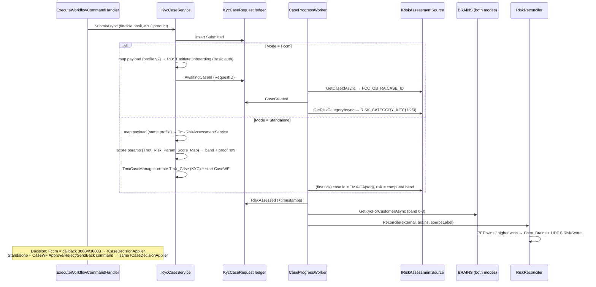
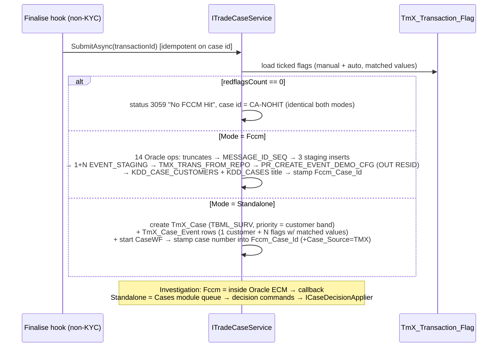

# Oracle FCCM Integration — Analysis, Gap Assessment & Dual-Mode (Oracle / Standalone) Architecture

**Status**: 📐 Analysis + architecture proposal for approval — no code changed.
**Date**: 2026-07-13
**Decisions locked with FSI**: (1) **BRAINS stays in both modes** — only Oracle FCCM becomes optional; TMX-computed risk reconciles against BRAINS with the same "higher risk wins / PEP always wins" rule. (2) Standalone case management is a **TMX Case module executing on the planned FSI workflow engine** (see `WORKFLOW_ENGINE_REPLACEMENT_PLAN.md`); FCCM-parity extras (correlation, merging) phase in later.
**Sources**: full read of `Infrastructure/Integrations/{Fccm,Brains}`, `Infrastructure/Kyc`, `KycCaseController`/`KycRiskAssessmentController`, onboarding mapping profiles, legacy `Integration KYC` project (incl. `PR_CREATE_EVENT_DEMO` DDL), `docs/LEGACY_FCCM_TRADE_FLOW.md`, `docs/onboarding-mapping/ONBOARDING_MAPPING_DESIGN.md`, and the official *Brains to TBML interface document* (QueryKycInfo v2.0 + batch risk-level exchange), extracted 2026-07-13 (`_brains_tbml_extract.txt` at workspace root).

---

## Table of contents

1. [System context](#1-context)
2. [KYC onboarding — complete current flow](#2-kyc)
3. [TBML case creation — complete current flow](#3-tbml)
4. [Advanced FCCM capabilities inventory](#4-fccm-capabilities)
5. [Gap analysis — FCCM vs TMX today](#5-gaps)
6. [Dual-mode architecture](#6-dual-mode)
7. [Standalone TMX module design](#7-standalone-design)
8. [Configuration & feature-toggle surface](#8-config)
9. [Sequence diagrams (both modes)](#9-sequences)
10. [Implementation phases & effort](#10-phases)
11. [Risks & mitigations](#11-risks)
12. [Open items](#12-open-items)

---

<a id="1-context"></a>
## 1. System context

Three systems participate in compliance decisioning today:

| System | Role | Protocol | Fate |
|---|---|---|---|
| **TMX** (FSI.Trade.Compliance + React FE) | Transaction capture, dynamic forms, maker-checker workflow, red-flag engine (manual + auto), reporting | — | Grows in Standalone mode |
| **BRAINS** (ICBC in-house screening) | Customer KYC risk level query (`QueryKycInfoServlet`, v2.0): request `TASK_NO/ZONENO/ADJUST_TYPE(0=new,1=existing)/CUSTNO/REG_TYPE/REG_NO/…` → response `STATUS ∈ {0=PEP, 1=High, 2=Medium, 3=Low}`, `TRANSOK`, `ERROR_NO/MSG`. Also a **batch file exchange** with TBML (char(27)-separated files via Etran agent): TBML→BRAINS `TBML_RISKLEVEL` (full customer list w/ `C_RISK_LEVEL`, `C_TB_FLAG`) and BRAINS→TBML `BRAINS_RISKLEVEL` (adds `D_NEXT_REVIEW_DATE`, `C_STATUS` 1=Normal…5=new-customer-denied) | HTTP + batch files | **Stays in both modes** |
| **Oracle FCCM / OFSAA** (Mantas + ECM + OB) | KYC onboarding risk assessment (`FCC_OB_RA`), parameter risk scoring (`FCC_OB_RISK_PRMS_CODE_SCRE_MAP`), TBML case creation (`PR_CREATE_EVENT_DEMO` → `KDD_CASES` + event chain), investigator case workflow, Approve/Reject/Send-back decisions via callback | Oracle SQL (staging + reads) + HTTP onboarding + HTTP callback | **Becomes optional (dual mode)** |

Two known deployment quirks that shape the design: the target Oracle env (`ofsaadb`) exposes onboarding objects under **`OFSAAFCCM`**, not `MANTAS` (schema is already configurable via `Integration:FccmOracleSchema` + `ALTER SESSION SET CURRENT_SCHEMA`), and the **trade staging objects don't exist there yet** (DBA provisioning pending since 2026-06-09) — i.e. the TBML write path is *already* effectively stubbed in that environment, which strengthens the case for a first-class standalone mode instead of an accidental one.

---

<a id="2-kyc"></a>
## 2. KYC onboarding — complete current flow (Oracle FCCM mode)

### 2.1 Trigger and submission

1. Analyst creates a KYC transaction (product `KYC`) → maker-checker workflow (`KYC_Workflow` scheme). One-active-KYC-per-customer gate at create (409 `kyc_active_exists`).
2. Authorizer fires `AuthorizeOrProceedToFccm` → workflow finalises → `ExecuteWorkflowCommandHandler.TryFireCaseInsertionAsync` → product name `"KYC"` → **`IKycCaseService.SubmitAsync`** (double-submit guarded by `KycCaseRequests.Any(TransactionId)`). The same hook fires from **periodic review**: `KycReviewOrchestrator` clones a due KYC transaction and drives its workflow (`SendToAuthorizer → AssignToMe → AuthorizeOrProceedToFccm`) as user "PERIODIC REVIEWER".
3. `FccmKycCaseService.SubmitAsync`: insert `KycCaseRequest` (`Status=Submitted`) → return immediately (non-blocking; replaces legacy 20-second in-request poll) → `FireOnboardingAsync`.

### 2.2 Payload build (risk-parameter derivation)

- **Config-driven mapper (active path)**: `OnboardingPayloadMapper` walks a JSON `MappingProfile` (`Mappings/onboarding/onboarding.{v1|v2|legacy}.mapping.json`, `extends` inheritance, hot-reloadable) against snapshot + detail UDF + customer UDF. Source kinds `const/context/snapshot/udf.direct/udf.hidden/udf.auto/grid.maxScore/grid.first/row.*`; transforms `valueMap/dateFormat/cast/default/…`.
- **Resolver mechanisms** (mirrored in the hardcoded fallback `KycOnboardingFieldResolver`): (1) DIRECT `KycParam*` values; (2) SINGLE-HIDDEN via `TmX_Lookup.Hidden_Value`; (3) **MULTI MAX-SCORE — the FCCM dependency**: a grid's candidate codes are ranked by `SELECT … FROM FCC_OB_RISK_PRMS_CODE_SCRE_MAP WHERE SCORE = MAX(...)` (Oracle) and the highest-scoring code wins (e.g. country of residence from `TmxKYCSPOR`). Plus `HS_CD` from the first HS-code grid row.
- HTTP: `POST {FccmOnboardingUrl}` (`InitiateOnboardingService/OB/Initiate`), Basic auth, PascalCase JSON, strict-schema toggles (`IncludeCustomerName/IncludeNameParts/IncludeRiskParameterFields`). Response `RequestID` → `Status=AwaitingCaseId`; failure → `Failed` + `Error_Detail` (+ full exchange log in `Fccm_Request/Response_Payload`).

### 2.3 What Oracle FCCM does next (its responsibilities)

Inside FCCM: onboarding request → **risk assessment** (`FCC_OB_RA` row) → **KYC case** in ECM (`KDD_CASES`/`KDD_CASE_CUSTOMERS`) → **investigator workflow inside FCCM** (assignment, review, escalation — entirely invisible to TMX) → decision callback.

The `FCC_OB_RA` DDL (`OFSAA DDL/Tables/FCC_OB_RA.txt`) shows the assessment record is richer than what TMX reads: `REQUEST_ID (PK)`, `OB_CUST_SEQ_ID`, **`RISK_SCORE NUMBER(5,2)`** (continuous algorithmic score), **`RISK_CATEGORY_KEY`** (derived band — the only score field TMX consumes), `STATUS_CD` (assessment lifecycle), **`JURISDICTION_CD`** (jurisdiction-scoped risk models; indexed with created-date), **`OVERRIDDEN_RISK_SCORE NUMBER(5,2)`** (score override capability), `CASE_ID`, **`RCMND_TO_ONBRD CHAR(1)`** (onboard/don't-onboard recommendation verdict), created stamps. This is the OFSAA KYC **two-stage assessment model**: (1) **rule-based assessment** — priority rules that force an outcome regardless of arithmetic (PEP/watchlist/high-risk-jurisdiction style rules); (2) **algorithm-based assessment** — per-parameter code→score maps (`FCC_OB_RISK_PRMS_CODE_SCRE_MAP`, the table TMX already queries) combined with parameter **weights** into the continuous `RISK_SCORE`, then banded into `RISK_CATEGORY_KEY` via configurable score ranges, with override and recommendation on top. §7.1 replicates this model in full — the standalone engine must provide **nothing less**, even though today's TMX pipeline consumes only the band (Appendix A tracks parity item-by-item).

### 2.4 TMX-side polling, reconciliation, decisioning

- **`FccmCaseIdPoller`** (BackgroundService, `PollingInterval` 5 s, batch 50): Phase A `AwaitingCaseId` → read `CASE_ID` from `FCC_OB_RA` → `CaseCreated` (+`Case_Created_At`), timeout after `CaseIdTimeout` (5 min) → `Timeout`. Phase B `CaseCreated` → read `RISK_CATEGORY_KEY` → `RiskAssessed` (+`Risk_Assessed_At`) → **`ReconcileRiskAsync`**.
- **Reconciliation** (identical in legacy `caseInsertionController.UpdateRiskInRepo` and new poller): FCCM 1/2/3 (Low/Med/High) vs BRAINS 0/1/2/3 (PEP/High/Med/Low via `IKycScreeningService`). BRAINS PEP **always wins**; otherwise higher risk wins; tie → FCCM value with suffix `" - BRAINS & TBML SCORES ARE EQUAL"`; winner suffix `" - TBML"` or `" - BRAINS"`. Writes: upsert `Cstm_Brains` (`FCCM_Score/Brains_Score/Final_Score/Display` by `Transaction_ID`) + stamp `$.RiskScore` (Display) into the customer snapshot UDF. Best-effort FCCM write-backs: `KDD_CASE_CUSTOMERS.FULL_NM` (from `FCC_OB_CUST`) and `KDD_CASES.PRIORITY_CD` (from risk).
- **Decision callback** (`POST /api/v1/Kyc/Case/Callback` + 2 legacy aliases, `[AllowAnonymous]`, `FccmCallbackSharedSecret` configured but **not enforced** — see §11 R6): `{caseID, actionCode}` → `FccmActionCodeStatusMap` (default `30004/983 → APPROVED`, `30003/984 → REJECTED`) → `TmX_Transaction.Transaction_Status_Lkp` + `ApplicationRemark` + KYC row `RiskAssessed/Failed`; terminal decisions upsert `CustomerReviewSchedule` (`INextReviewDateCalculator` — band-based next review date, mirroring the BRAINS batch file's `D_NEXT_REVIEW_DATE` concept). Legacy had a third callback branch — any other action code = **send back to analyst** (`SetApplicationState AnalystActivity/423`); the new callback handles Approve/Reject only (parity gap tracked in §5).
- **Operations** (`Kyc.Operate`, Risk Assessment tab): `Retry` (re-fire onboarding on same row from `Failed/Timeout`), `Repoll` (one-shot Phase A/B), `Refresh` (re-read risk + re-reconcile).

**Responsibility split (KYC)**: TMX owns capture, maker-checker approval, payload derivation *inputs*, reconciliation, review scheduling, status/audit. **FCCM owns: parameter risk scoring (score map), final onboarding risk category, KYC case record, investigator workflow, Approve/Reject decision.** BRAINS owns the independent screening band.

---

<a id="3-tbml"></a>
## 3. TBML case creation — complete current flow (Non-KYC products, Oracle FCCM mode)

**Trigger**: same finalise hook, non-KYC branch → `IFccmTradeCaseService.SubmitAsync(transactionId)` — idempotent on `Transaction.Fccm_Case_Id`.

**Red-flag inputs**: ticked `TmX_Transaction_Flag` rows (manual MRL picks + auto-flag engine hits, `Flag_Description` + `[MatchedValue]` for auto). Legacy parity note: legacy also *derived* flags at submit time from `REPO_SANCTIONED_COUNTRIES`/`REPO_SCREENING_GOODS` (SQL Server); the new stack computes these earlier via the Auto-Flags engine — same net effect, cleaner ownership.

**Pipeline (`FccmTradeCaseService.SubmitInternalAsync`, 14 Oracle ops via ADO.NET, `CURRENT_SCHEMA=MANTAS`)**:
truncate `RT_CASE_TRACKING` + `EVENT_STAGING` → `MESSAGE_ID_SEQ.nextval` → insert `RT_CASE_TRACKING` → insert `LC_TRN_DET_STAGING` (trade fields from detail UDF) + `CUST_MASTER_STAGING` (snapshot) + `BENEFICIARY_DETAIL_STAGING` → insert `EVENT_STAGING` 1×customer-details event + N×flag events →
- **`redflagsCount == 0`** → **CA-NOHIT branch**: no case; `Transaction_Status_Lkp = 3059` ("No FCCM Hit"), `Fccm_Case_Id = "CA-NOHIT"` sentinel; stop.
- **`> 0`** → insert `TMX_TRANS_FROM_REPO` correlation row → call **`PR_CREATE_EVENT_DEMO_CFG`** (`MESSAGE_ID`, `PRODUCT='FT'` hardcoded, `NUM=1`, + 14 `TradeCaseDefaults` params; **OUT `RESID`** = case id) → insert `KDD_CASE_CUSTOMERS` → update `KDD_CASES.CASE_TITL_NM = TransactionNumber` → stamp `Transaction.Fccm_Case_Id`.

**What the SP does inside FCCM** (from `OFSAA DDL/Proc/PR_CREATE_EVENT_DEMO.txt`): creates the case as `"CA" + CM_CASES_SEQ.NEXTVAL` with `STATUS_CD='CR'`, `CASE_TYPE_CD/SUBTYPE_CD='TBML_SURV'`, `OWNER_ORG='ICBC'`, `JRSDCN_CD='PAK'`, owner/assignee defaulted (internal id 10004), **`PRIORITY_CD` hardcoded `'High'`** for every trade case — and *hand-writes the entire artifact chain a native Mantas scenario run would produce*: `FCC_EVENTS` (`V_SCENARIO_CLASS='TBML'`, `V_EVENT_TYPE='TBAML'`), `fcc_event_entity_map`, `fcc_event_details`, `FCC_CORRELATION_EVENT_MAP`, `FCC_EVENT_INVESTIGATION_STATUS`, `FCC_PRECASE_CASE_MAP`, product-aware `KDD_CASE_TRD_FIN_{CNTRCT_EVT,CNTRCT,GOOD_SRVC,PARTY}` and `CASEIDTOTRANSACTION`; customer risk sourced from bank-custom `CUST_RISK_MAP_CSTM`. **Implication: the deployment already bypasses FCCM's behaviour-detection engine — "cases" are direct inserts driven entirely by TMX-supplied red flags.** The intelligence lives in TMX; FCCM contributes the case container + investigator UI.

**Assignment/status/notifications**: happen inside FCCM's ECM, invisible to TMX. Status returns only via the same callback (Approve/Reject → transaction status; legacy send-back branch existed). Emails/SMS: none on the integration path (workflow Bucket-C notification actions are separate and currently no-op). **Resubmit**: `POST /Transaction/{id}/ResubmitToFccm` (`Transactions.Resubmit`) clears `Fccm_Case_Id` and re-runs; old staging rows are left in place (compliance-side dedup).

---

<a id="4-fccm-capabilities"></a>
## 4. Advanced FCCM capabilities inventory

Classified by evidence: **[USED]** = exercised by this deployment (code-observable), **[BYPASSED]** = FCCM has it but this deployment routes around it, **[INTERNAL]** = used implicitly inside FCCM, invisible to TMX.

| Capability | Class | Evidence & notes |
|---|---|---|
| Onboarding risk assessment (`FCC_OB_RA` request→case→risk pipeline) | **[USED]** | The KYC poller's entire read surface |
| Parameter risk scoring (`FCC_OB_RISK_PRMS_CODE_SCRE_MAP`) | **[USED]** | Max-score resolution during payload build — used *twice*: by TMX at derivation time and by FCCM internally |
| Case container + numbering (`KDD_CASES`, `CA{seq}`) | **[USED]** | Both flows produce a `KDD_CASES` row |
| Investigator case workflow (assignment, review, escalation, comments) | **[INTERNAL]** | Only a tri-state crosses back: Approve / Reject / (legacy) send-back-to-analyst |
| Alert/event model + correlation (`FCC_EVENTS`, `FCC_CORRELATION_EVENT_MAP`, `FCC_PRECASE_CASE_MAP`) | **[BYPASSED]** | Hand-inserted by the SP with fixed values — no native scenario/correlation engine runs for this flow |
| Behaviour detection scenarios (Mantas batch) | **[BYPASSED]** | `PR_CREATE_EVENT_DEMO` explicitly fakes scenario output; TMX red flags are the real detection |
| Duplicate detection / entity resolution | **[INTERNAL/partial]** | Onboarding matches existing customers (`EXISTING_CUST_INTRL_ID` → `FCC_OB_CUST`); no TMX-visible dedup on trade cases (each submit = new case; resubmit intentionally creates a new one) |
| Case merging / linking | **[INTERNAL]** | ECM feature; nothing in the integration reads or writes links. Correlation keys TMX holds: `MESSAGE_ID`, `REQUEST_ID`, `CASE_ID`, `TMX_TRANS_FROM_REPO`, `CASEIDTOTRANSACTION` |
| Entity relationship handling (parties/goods/contracts per case) | **[USED-lite]** | SP writes `KDD_CASE_TRD_FIN_*` (contract/goods/party) rows from staging — flat snapshots, not a graph |
| Audit trail (case actions inside ECM) | **[INTERNAL]** | Not surfaced; TMX keeps its own transaction-side audit |
| Risk recalculation / periodic re-review | **[SHARED]** | FCCM computes at onboarding; **TMX already owns the periodic cadence** (`CustomerReviewSchedule` + `KycReviewOrchestrator` + `INextReviewDateCalculator`) — re-runs the full onboarding loop per review. BRAINS batch file (`D_NEXT_REVIEW_DATE`, `C_STATUS`) shows the bank-level risk-sync concept |
| Batch risk-level exchange with BRAINS (`TBML_RISKLEVEL`/`BRAINS_RISKLEVEL` files) | **[INTERNAL to FCCM↔BRAINS]** | Per the interface doc, TBML(FCCM) exchanges full customer risk lists with BRAINS via Etran file drops — an FCCM-side obligation that must be re-homed if FCCM is decommissioned (open item §12.4) |
| Watchlist/sanctions screening | **[NOT USED here]** | Sanctions logic lives in TMX (`REPO_SANCTIONED_COUNTRIES` / auto-flags); BRAINS covers customer screening |
| Notifications from case events | **[INTERNAL]** | None cross the integration boundary |
| Regulatory reporting (STR/CTR from cases) | **[UNKNOWN/INTERNAL]** | Not observable from the integration; confirm with compliance ops (§12.5) |

---

<a id="5-gaps"></a>
## 5. Gap analysis — what Standalone TMX mode must add

TMX already owns (no gap): transaction capture + dynamic forms; maker-checker approval workflow (OptimaJet → FSI engine); red-flag detection (manual + auto-flag engine w/ aggregates, reference lists, proof); BRAINS client + sandbox; reconciliation math + `Cstm_Brains`; periodic review scheduling/orchestration; transaction audit (`TmX_Audit_Log`, history); RBAC; reporting; `KycCaseRequest` lifecycle ledger + Risk Assessment tab UI.

| # | Gap (FCCM does it today) | Standalone TMX replacement | Effort | Phase |
|---|---|---|---|---|
| G1 | **Onboarding risk model** — full `FCC_OB_RA` surface: rule-based assessment + algorithm-based weighted scoring (`FCC_OB_RISK_PRMS_CODE_SCRE_MAP` + weights) → continuous `RISK_SCORE(5,2)` → `RISK_CATEGORY_KEY` banding by configurable ranges, per `JURISDICTION_CD`, with `OVERRIDDEN_RISK_SCORE` and `RCMND_TO_ONBRD` recommendation | Config-driven two-stage engine (§7.1): rule table + weighted param scoring + band ranges + recommendation + override + model versioning — all admin-maintained; imports FCCM's model config. Same 1/2/3 band vocabulary so reconciliation is untouched; continuous score + per-param proof surfaced as add-ons | **L** | S1 |
| G2 | **Case container** — `KDD_CASES` record, `CA{seq}` numbering, title, priority | `TmX_Case` table + `TMX-CA{seq}` numbering; priority from reconciled band (fixes FCCM's hardcoded `'High'` on trade) | **M** | S1 |
| G3 | **KYC case decision** — investigator Approve/Reject in ECM + callback | Case decision executes on a `CaseWF` scheme (FSI workflow engine) with `Case.Investigate/Approve/Reject/SendBack` commands; decision applies the *same* status writes the callback does today (shared `ICaseDecisionApplier`) — including restoring the **send-back-to-analyst** branch legacy had | **M** | S1 |
| G4 | **TBML case content** — staging → event rows → party/goods/contract snapshots | `TmX_Case_Event` (one per red flag + customer event; stores matched value/proof link) + `TmX_Case_Party` / reuse of existing transaction detail (no staging needed — the case links to the live transaction) | **M** | S1 |
| G5 | **Investigator workspace** — FCCM ECM UI | FE Cases module (the `/cases` route is a placeholder today): queue grid (filter by status/priority/type), case detail (events, transaction link, customer risk, decision actions, notes), driven by the workflow engine's inbox — reuses Inbox patterns | **L** | S1–S2 |
| G6 | Assignment & queues | `CheckRole`-actor `CaseWF` activities + `WorkflowInbox` (same mechanism as transactions); claim (`AssignToMe`) narrowing already proven | **S** | S1 |
| G7 | Case audit trail | `WorkflowProcessTransitionHistory` (engine) + `TmX_Case_Audit` for non-transition actions (notes, priority change, reassign) | **S** | S1 |
| G8 | Duplicate detection | v1: create-time guard — open case exists for same (customer, product class) → link instead of duplicate (config). Full entity-resolution dedup deferred | **S(v1)/L(full)** | S2/S3 |
| G9 | Case correlation & linking | `TmX_Case_Link` (case↔case, typed: duplicate/related/merged-into) + auto-link by customer code + `TMX_TRANS_FROM_REPO`-equivalent kept internally (`TmX_Case.Transaction_Id`) | **M** | S2 |
| G10 | Case merging | Merge = link type `merged-into` + close source case with disposition; events re-parented | **M** | S2 |
| G11 | Alert correlation (many flags → one case, cross-transaction) | v1: per-transaction case (parity with today's per-submit case). v2: correlation window rule (same customer, open case, N days) attaches new events to the open case | **M** | S2 |
| G12 | Notifications (case assigned/decided) | The workflow engine's Bucket-C notification actions (Slice 8 `IDlpNotificationClient` backlog item) — shared investment, not FCCM-specific | **M** | S2 (with Slice 8) |
| G13 | Risk recalculation on demand | `Refresh` operation re-runs `TmxRiskAssessmentService` instead of re-reading `FCC_OB_RA` (provider swap, §6); periodic review loop unchanged | **S** | S1 |
| G14 | Entity relationship graphs | Deferred — flat party/case links first; graph visualisation only if compliance asks | **XL** | S3/never |
| G15 | BRAINS↔TBML batch risk-level file exchange | If FCCM is fully decommissioned at the bank (not just for TMX), TMX must emit/consume `TBML_RISKLEVEL`/`BRAINS_RISKLEVEL` files (Etran drop, char(27) separator, documented format) — a small batch job, but **confirm ownership first** (§12.4) | **M** | S3/confirm |
| G16 | Regulatory reporting from cases | Unknown scope — confirm what compliance extracts from FCCM today (§12.5); TMX reports engine (DotLiquid/Excel) can render once data exists | **?** | confirm |

**Data dependencies to import once**: `FCC_OB_RISK_PRMS_CODE_SCRE_MAP` (scoring rows) and the band thresholds behind `RISK_CATEGORY_KEY`; `CUST_RISK_MAP_CSTM` semantics (customer risk for case enrichment — standalone uses `Cstm_Brains`/snapshot instead).

---

<a id="6-dual-mode"></a>
## 6. Dual-mode architecture (configuration-driven, no code changes to switch)

### 6.1 Principle

The Application layer already speaks to compliance upstreams through **vendor-neutral ports** (`IKycCaseService`, `IFccmTradeCaseService`, `IKycCaseOperationsService`, `IKycScreeningService`) — the same seam pattern that lets BRAINS swap to `SandboxKycScreeningService` via `Integration:Brains:Mode`. Dual mode generalises that precedent: **one new config switch selects which *provider set* fulfils the same ports.** Orchestration (`ExecuteWorkflowCommandHandler`, poller-equivalents, reconciliation, review scheduling, Risk Assessment tab) is shared; only the providers behind the seams differ. No duplication of flow logic.

```mermaid
flowchart TB
    subgraph SHARED["Shared (mode-agnostic) — unchanged flow logic"
        ]
        EH[ExecuteWorkflowCommandHandler<br/>TryFireCaseInsertionAsync]
        LEDGER[(KycCaseRequest ledger + Cstm_Brains)]
        REC[RiskReconciler<br/>higher wins / PEP wins]
        REV[KycReviewOrchestrator + CustomerReviewSchedule]
        RATAB[KYC Risk Assessment tab + operations]
        BR[IKycScreeningService → BRAINS (both modes)]
    end

    subgraph PORTS["Ports (existing + 2 new)"]
        P1[IKycCaseService]
        P2[ITradeCaseService*<br/>(*renamed from IFccmTradeCaseService)]
        P3[IKycCaseOperationsService]
        P4[IRiskAssessmentSource — NEW<br/>case-id + risk category provider]
        P5[ICaseDecisionApplier — NEW<br/>shared status/remark/review writes]
    end

    subgraph FCCM["Mode = Fccm (today's providers)"]
        F1[FccmKycCaseService]
        F2[FccmTradeCaseService]
        F3[FccmOracleReader + FccmHttpClient + FccmCaseIdPoller]
        F4[Callback endpoint → ICaseDecisionApplier]
    end

    subgraph TMX["Mode = Standalone (new providers)"]
        T1[TmxKycCaseService]
        T2[TmxTradeCaseService]
        T3[TmxRiskAssessmentService<br/>local score map + banding]
        T4[TmxCaseManager + CaseWF on FSI workflow engine<br/>decision → ICaseDecisionApplier]
    end

    EH --> P1 & P2
    RATAB --> P3
    P1 -->|Fccm| F1
    P1 -->|Standalone| T1
    P2 -->|Fccm| F2
    P2 -->|Standalone| T2
    P4 -->|Fccm| F3
    P4 -->|Standalone| T3
    F4 --> P5
    T4 --> P5
    REC --- P4
    BR --- REC
```

### 6.2 The abstraction layer — what exists vs what's new

| Seam | Today | Change |
|---|---|---|
| `IKycCaseService` (Submit/Resubmit/GetStatus/HandleCallback) | Sole impl `FccmKycCaseService` | + `TmxKycCaseService`. Interface unchanged. |
| `IFccmTradeCaseService` | Sole impl `FccmTradeCaseService` | **Rename → `ITradeCaseService`** — mechanical rename across ~6 files (interface, impl, DI registration, `ExecuteWorkflowCommandHandler`, `ResubmitTransactionToFccmCommand`+Handler, doc comments); takes the vendor name out of Application per the §3.4 naming convention. + `TmxTradeCaseService`. |
| `IKycCaseOperationsService` (Retry/Repoll/Refresh) | FCCM-bound | + standalone impl (Retry=re-run scoring; Repoll=no-op success; Refresh=re-score+re-reconcile). Interface unchanged. |
| **`IRiskAssessmentSource` (NEW)** | Implicit — poller reads `FCC_OB_RA` inline | Extracted port: `GetCaseIdAsync(requestRef)` / `GetRiskCategoryAsync(requestRef)`. Fccm impl wraps `FccmOracleReader`; Tmx impl computes synchronously (score map). The **shared** `CaseProgressWorker` (generalised `FccmCaseIdPoller`) drives the ledger through `AwaitingCaseId→CaseCreated→RiskAssessed` against whichever source — in standalone mode transitions complete on the first tick. |
| **`ICaseDecisionApplier` (NEW)** | Logic lives inside `HandleCallbackAsync` | Extracted: apply decision (Approve/Reject/SendBack) → transaction status via `FccmActionCodeStatusMap`-equivalent, `ApplicationRemark`, KYC row terminal state, `CustomerReviewSchedule` upsert. Called by the FCCM callback **and** by `CaseWF` command post-hooks — one implementation, two triggers. |
| `IKycScreeningService` (BRAINS) | `BrainsKycScreeningService` / Sandbox | **Untouched — both modes.** |
| Reconciliation | Static method on the poller, FCCM-labelled | Extract `RiskReconciler` (Application): inputs `(externalScore, brainsScore, sourceLabel)`; suffix becomes `" - {sourceLabel}"` (`TBML` in Fccm mode, `TMX` in standalone). Math identical. `Cstm_Brains.FCCM_Score` column stores the external score in both modes (column name kept; documented). |
| Onboarding payload mapper | Vendor-neutral already | Standalone mode simply doesn't call HTTP — `TmxKycCaseService` feeds the same `OnboardingMappingContext` values into `TmxRiskAssessmentService` (profile-driven parameter extraction is **reused**, with `grid.maxScore` resolving against the local score table via the existing resolver seam). |
| `KycCaseRequest` ledger | FCCM-named columns | **Reused as-is in both modes** (zero migration risk): standalone writes `Fccm_Request_Id = "TMX-{guid}"`, `Fccm_Case_Id = TmX_Case.CaseNumber`, `Risk_Category_Key` = computed band. Additive column `Case_Source (nvarchar(16))` = `FCCM|TMX` for reporting clarity. |

### 6.3 What is shared vs mode-specific (duplication audit)

**Shared (single implementation)**: finalise hook + double-submit guards + CA-NOHIT semantics; ledger + lifecycle states; `CaseProgressWorker`; `RiskReconciler` + `Cstm_Brains` writes + UDF stamp; review scheduling/orchestrator; Risk Assessment tab (DTO unchanged — labels via `sourceLabel`); resubmit endpoints + privileges; mapping profiles; audit/logging pipeline. **Fccm-only**: Oracle reader, HTTP client, callback endpoint (stays mounted in both modes but 404s/ignores when standalone — or better, stays live during migration overlap), staging pipeline. **Standalone-only**: scoring service + score-map table/admin, `TmX_Case*` tables + `TmxCaseManager`, `CaseWF` scheme, Cases FE module. Net: no flow logic exists twice; only *providers* differ.

---

<a id="7-standalone-design"></a>
## 7. Standalone TMX module design

### 7.1 Risk model (`TmxRiskAssessmentService`) — full FCCM-parity, rule-based + algorithm-based, configuration-driven

Replicates the OFSAA KYC two-stage model end-to-end (**nothing less** — Appendix A is the parity checklist). Every element is table/config-driven and admin-maintainable; no scoring logic is hardcoded.

**Configuration tables (all jurisdiction- and model-version-scoped, maker-checker via the existing `TmX_Request` pattern, `RiskConfig.Manage` privilege):**

| Table | Purpose (FCCM counterpart) |
|---|---|
| `TmX_Risk_Model` | Model header: `Model_Id, Jurisdiction_Cd, Version, Status (Draft/Active/Retired), Effective_From, approval stamps` — versioned models; exactly one Active per jurisdiction; assessments stamp the model version they used (FCCM: jurisdiction-scoped model config; `FCC_OB_RA.JURISDICTION_CD`) |
| `TmX_Risk_Parameter` | Parameter registry: `Param_Code, Label, Source (udf path/mapper key), Data_Type, Multi_Value_Strategy (MaxScore default)` (FCCM: onboarding risk parameters) |
| `TmX_Risk_Param_Weight` | `Model_Id, Param_Code, Weight decimal` — the **algorithm-based** weighting (FCCM: parameter weights per jurisdiction/customer type) |
| `TmX_Risk_Param_Score_Map` | `Model_Id, Param_Code, Code_Value, Score decimal(5,2)` — value→score map, one-time import from `FCC_OB_RISK_PRMS_CODE_SCRE_MAP` + admin CRUD (FCCM: the exact table TMX already queries for max-score) |
| `TmX_Risk_Rule` | **Rule-based assessment**: `Model_Id, Rule_No (priority), Predicate (param/op/value(s) — same safe-expression grammar as the Auto-Flags/Workflow expression evaluator), Outcome (Force_Band \| Force_Score \| Not_Recommended), Stop_On_Match bit, Reason_Template` (FCCM: rule-based risk assessments that trump the arithmetic — PEP, prohibited jurisdiction, watchlist class rules) |
| `TmX_Risk_Band_Config` | `Model_Id, Band_Key (1/2/3), Label, Score_From, Score_To` — continuous score → `RISK_CATEGORY_KEY`-equivalent band via configurable ranges (FCCM: risk-category score ranges) |
| `TmX_Risk_Recommendation_Config` | `Model_Id, Band_Key → Rcmnd_To_Onbrd (Y/N/Review)` — reproduces `FCC_OB_RA.RCMND_TO_ONBRD` (FCCM: auto-recommendation thresholds) |

**Assessment pipeline (deterministic, per request):** resolve parameter values from the *same* `OnboardingMappingContext` the FCCM payload uses today (mapper reuse — §6.2) → **Stage 1 rule pass** in `Rule_No` order: first matching `Stop_On_Match` rule can force band/score/recommendation (rule hit recorded with reason) → **Stage 2 algorithm pass**: per-parameter score via score map (multi-value grids resolved by `Multi_Value_Strategy`, default MaxScore = today's `GetMaxScoreCodeValueAsync` semantics) → weighted aggregate `RISK_SCORE = Σ(wᵢ·sᵢ)/Σwᵢ` as `decimal(5,2)` → **banding** via `TmX_Risk_Band_Config` → **recommendation** via config → persist.

**Assessment record `TmX_Risk_Assessment`** — supersets `FCC_OB_RA`: `Assessment_Id, Request_Id, Model_Id+Version, Jurisdiction_Cd, Risk_Score decimal(5,2), Overridden_Risk_Score decimal(5,2) NULL, Override_By/At/Reason, Risk_Category_Key, Status_Cd (Computed/Overridden/Superseded), Rcmnd_To_Onbrd, Rule_Hit (rule no + reason) NULL, Inputs_Json, Param_Scores_Json (per-parameter value/score/weight), Computed_At/By`. The per-parameter proof JSON makes every score fully explainable — stronger auditability than FCCM's black box, surfaced in the Risk Assessment tab's detail panel in standalone mode (an add-on, not a regression).

**Score override** (parity with `OVERRIDDEN_RISK_SCORE`): privileged action (`RiskConfig.Override` or case-investigator command on `CaseWF`) writes `Overridden_Risk_Score` + reason; band recomputed from the overridden score; original score retained; audit row.

**Calibration & sign-off**: exact FCCM weights/rules/ranges are FCCM-side config, not fully observable from TMX. Primary path: **export the model config from the FCCM admin console** (parameters, weights, rules, category ranges per jurisdiction) and import it (§12.1). Fallback: reverse-calibrate against historical pairs (`KycCaseRequest.Risk_Category_Key` + logged payloads → recomputed scores). Either way, compliance signs off the Active model before Standalone go-live, and S0's shadow scoring (compute-and-log next to live FCCM results) provides the evidence.

### 7.2 Case model (additive tables, TMX-owned)

`TmX_Case` (`Case_Id PK`, `Case_Number "TMX-CA{seq}"`, `Case_Type KYC|TBML_SURV`, `Transaction_Id`, `Customer_Code`, `Priority` (from reconciled band), `Status_Lkp`, `Process_Instance_Id` (CaseWF), `Opened/Closed_At/By`, `Disposition`, `Source = TMX`); `TmX_Case_Event` (`Event_Id`, `Case_Id`, `Flag_Scope_Id?`, `Description`, `Matched_Value`, `Event_Type Customer|Flag`, `Created_At`) — the internal replacement for `EVENT_STAGING` rows; `TmX_Case_Link` (`From_Case, To_Case, Link_Type duplicate|related|merged_into`, audit) — S2; `TmX_Case_Audit` (non-transition actions). Party/goods/contract detail is **not copied** — the case references the live transaction (TMX has the data FCCM needed staged).

### 7.3 Case workflow (`CaseWF` on the FSI workflow engine)

New scheme authored like any other (designer-editable): `CaseCreated → InvestigatorPool (CheckRole "Case Investigator", FillAllUsersBucket) → Assigned (AssignToMe claim-narrowing — mechanism already proven) → Decision` with commands `Approve` / `Reject` / `SendBackToAnalyst` / `Escalate`; final activities per disposition. Command post-hook (same pattern as `TrySyncTransactionStatusAsync`) calls `ICaseDecisionApplier` — so a standalone Approve produces byte-identical transaction-side effects to today's FCCM callback `30004`. Roles: new `Case Investigator` role + `Cases.View/Cases.Operate` privileges (rbac_grants.sql additions). KYC cases: created at `RiskAssessed`; TBML cases: created at trade finalise when `redflagsCount > 0` (CA-NOHIT branch identical to today).

### 7.4 FE Cases module (fills the `/cases` placeholder route)

Queue page (grid: case number, type, customer, priority, status, age, assignee; KPI strip; claim/act via workflow inbox pattern) + Case detail page (events list w/ matched values + flag proof links, transaction link, risk panel reusing Risk Assessment components, decision buttons = workflow commands, notes, audit). Gated by `Cases.View`; hidden entirely in Fccm mode (nav privilege + mode flag). Ledger entries per `FE_CHANGES_REQUIRED.md` process when built.

---

<a id="8-config"></a>
## 8. Configuration & feature-toggle surface

```jsonc
"Integration": {
  "CaseManagement": {
    "Mode": "Fccm",                    // "Fccm" | "Standalone"  ← THE switch
    "SourceLabel": "TBML",             // reconciliation suffix; "TMX" in standalone
    "Standalone": {
      "CaseNumberPrefix": "TMX-CA",
      "AutoLinkOpenCaseSameCustomer": true,     // G8 v1 dedup guard
      "CorrelationWindowDays": 0                 // 0 = per-transaction case (parity); >0 enables G11 v2
    }
  },
  // Existing keys — Fccm mode only (ignored in Standalone):
  "FccmOnboardingUrl": "...", "FccmOracleConnection": "...", "FccmOracleSchema": "MANTAS",
  "Onboarding": { "MappingProfile": "v2", ... }, "TradeCaseDefaults": { ... },
  "FccmActionCodeStatusMap": { "30004": "APPROVED", "30003": "REJECTED" },
  "PollingInterval": "00:00:05", "CaseIdTimeout": "00:05:00",
  // Both modes:
  "Brains": { "Mode": "Live", "BaseUrl": "..." }
}
```

Rules: **one switch, validated at startup** (fail-fast like the Brains-sandbox production guard): `Mode=Fccm` requires `FccmOracleConnection` + `FccmOnboardingUrl` non-empty in Production (kills today's silent-stub failure mode, §11 R5); `Mode=Standalone` requires the score map table to be non-empty. DI in `InfrastructureServiceRegistration` selects the provider set from `Mode` — administrators switch by config + restart, **no code change**. The callback endpoint stays mounted in both modes (during any bank-side FCCM drain-down, late callbacks for pre-switch cases still apply via the shared applier); `Kyc.Operate` operations behave per provider. Mixed history is first-class: ledger rows carry `Case_Source`, so a customer can have FCCM-era and TMX-era executions in the same Risk Assessment history.

---

<a id="9-sequences"></a>
## 9. Sequence diagrams

### 9.1 KYC onboarding — both modes (divergence boxed)



### 9.2 TBML case — both modes



---

<a id="10-phases"></a>
## 10. Implementation phases & effort

Sequenced **after** the workflow-engine replacement reaches Phase 5 (CaseWF rides the FSI engine; running it on OptimaJet first would be throwaway work). Fccm mode keeps working throughout — every phase is additive behind the flag.

| Phase | Scope | Exit criteria | Effort |
|---|---|---|---|
| **S0. Seam extraction + calibration** | Rename `IFccmTradeCaseService`→`ITradeCaseService`; extract `IRiskAssessmentSource`, `ICaseDecisionApplier`, `RiskReconciler` (pure refactor, Fccm impls only — ships dark); import `FCC_OB_RISK_PRMS_CODE_SCRE_MAP` → `TmX_Risk_Param_Score_Map`; calibrate band formula against historical `Risk_Category_Key` values; startup config validation | Refactor deployed in Fccm mode with zero behaviour change (regression: existing KYC/TBML E2E); score-map imported; calibration report signed off (§12.1) | **1.5 wk** |
| **S1. Standalone core** | `TmxRiskAssessmentService` + proof rows; `TmX_Case`/`TmX_Case_Event`/`TmX_Case_Audit` migrations; `TmxKycCaseService`/`TmxTradeCaseService`/`TmxCaseOperationsService`; `CaseWF` scheme + `Case Investigator` role + privileges; decision parity via shared applier (incl. send-back branch); generalised `CaseProgressWorker` | In Standalone mode on a dev DB: KYC E2E (create→authorize→score→reconcile→case→approve→status APPROVED + review schedule) and TBML E2E (flags→case+events; zero-flag→CA-NOHIT) both green; Fccm mode regression green | **3 wk** |
| **S2. Cases FE module + hardening** | Cases queue + detail pages (fills `/cases`); dedup guard (G8 v1); case linking (G9); notifications wiring if Slice 8 landed (G12); Risk Assessment tab source-label + standalone proof panel; `FE_CHANGES_REQUIRED.md` entries | Investigator journey fully in-UI; mixed-history customer renders correctly; UAT sign-off in Standalone mode | **2.5–3 wk** |
| **S3. Optional/confirm-first** | Correlation window (G11 v2), case merging (G10), BRAINS batch file exchange (G15, if TMX inherits it), regulatory extract (G16), score-map admin screen with maker-checker | Per-item | per item (M each) |

**Standalone-capable in ~7 weeks** after S0 starts (S0–S2), independent of bank-side Oracle decommission timing. Rollback at any point = flip `Mode` back to `Fccm` (providers are stateless; ledger rows carry their source; TMX-era cases simply stop progressing if the bank reverts — they remain readable).

---

<a id="11-risks"></a>
## 11. Risks & mitigations

| # | Risk | L/I | Mitigation |
|---|---|---|---|
| R1 | **Band formula mismatch** — TMX-computed band diverges from FCCM's for the same inputs | M/H | S0 calibration against historical request/score pairs; shadow scoring in Fccm mode (compute-and-log TMX band next to FCCM's for every live assessment — diff report); compliance sign-off gate |
| R2 | Score map drifts after import (FCCM side keeps changing while both run) | M/M | Import script is re-runnable (diff mode); admin screen with maker-checker; drift report comparing live FCCM reads vs local table while in Fccm mode |
| R3 | Regulatory acceptance of TMX-issued cases (no Oracle ECM record) | M/H | Confirm with compliance before S1 exit (§12.5); TMX case audit is *more* granular (proof rows, engine history); keep FCCM-era records readable forever |
| R4 | CaseWF depends on FSI workflow engine timeline | M/M | Hard dependency declared (engine Phase 5); if the engine slips, S1 can temporarily author `CaseWF` as an OptimaJet scheme (same XML dialect — designed to be portable) at the cost of a later no-op re-test |
| R5 | Today's **silent stub** behaviour (blank Oracle conn ⇒ fake case ids in any environment) masks misconfiguration | H/M | Fixed in S0: startup validation makes stubs Development-only; Production requires real config for the selected mode |
| R6 | Callback endpoint is `[AllowAnonymous]` with `FccmCallbackSharedSecret` **declared but not enforced** | M/H | Enforce the shared secret in S0 (Fccm-mode fix independent of dual-mode); log + reject unsigned callbacks after a grace period |
| R7 | Hidden FCCM consumers at the bank (reports/feeds off KDD_* we don't see) | M/M | §12.5 discovery with compliance ops before any real decommission; TMX switch itself is reversible |
| R8 | Legacy send-back-to-analyst callback branch missing in new BE (parity gap even today) | H/L | Restored via `ICaseDecisionApplier` in S0 (add unmapped-action-code → SendBack mapping to `FccmActionCodeStatusMap` handling) |
| R9 | Two modes double the test surface | M/M | Shared-core design keeps mode-specific code thin; E2E suite parameterised by mode; CA-NOHIT/idempotency/reconciliation tests run identically against both |

---

<a id="12-open-items"></a>
## 12. Open items (confirm before/at S0)

1. **Risk model export**: request the full model configuration from the FCCM admin console — parameter list, per-parameter weights, **rule-based assessment definitions**, category score ranges, recommendation thresholds, per jurisdiction — as the primary import source for §7.1's config tables. Fallback: reverse-calibrate from historical pairs (`KycCaseRequest.Risk_Category_Key` + logged payloads). Compliance signs off the Active standalone model either way. Also confirm whether multiple jurisdictions/customer-type model variants are actually configured (only `PAK` observed in payloads).
2. **`FccmActionCodeStatusMap` completeness**: confirm the full action-code vocabulary FCCM can send (beyond 30004/30003/983/984) and the intended send-back semantics (legacy sent `AnalystActivity/423`).
3. **Case numbering/regulatory format**: is `TMX-CA{seq}` acceptable where `CA{seq}` appears in reports/filings today?
4. **BRAINS batch file exchange ownership** (G15): when Oracle FCCM is decommissioned bank-wide, does TMX inherit `TBML_RISKLEVEL`/`BRAINS_RISKLEVEL` file production/consumption, or does BRAINS integration change? (Interface doc: Etran agent drop, char(27) separator, `D_NEXT_REVIEW_DATE`/`C_STATUS` fields.)
5. **Compliance-ops discovery**: what do investigators/regulators extract from FCCM ECM today (reports, STR filings, dashboards)? Determines G16 scope and R3/R7 posture.
6. **`TradeCaseDefaults`** (14 SP params): which carry business meaning that `TmX_Case` must preserve vs FCCM-plumbing that dies with the SP?
7. **Environment reality check**: given the target Oracle env lacks the trade staging objects since June, confirm whether the bank still intends to provision them (Fccm mode fully live) or whether Standalone mode leapfrogs that DBA work entirely.

---

---

<a id="appendix-a"></a>
## Appendix A — Risk-scoring parity checklist (FCCM → Standalone, "nothing less")

Every risk-scoring capability observable from the FCCM side, its standalone equivalent, and status. ✚ = add-on beyond FCCM.

| FCCM capability (evidence) | Standalone equivalent (§7.1) | Parity |
|---|---|---|
| Parameter code→score maps (`FCC_OB_RISK_PRMS_CODE_SCRE_MAP`, queried live by TMX today) | `TmX_Risk_Param_Score_Map` (imported, then admin-owned) | ✅ Full |
| Multi-value resolution by highest score (`GetMaxScoreCodeValueAsync` semantics) | `Multi_Value_Strategy = MaxScore` default per parameter | ✅ Full |
| **Algorithm-based assessment** — weighted parameter aggregation → continuous `RISK_SCORE NUMBER(5,2)` (`FCC_OB_RA.RISK_SCORE`) | `TmX_Risk_Param_Weight` + weighted aggregate `decimal(5,2)` | ✅ Full |
| **Rule-based assessment** — rules that trump arithmetic (PEP/watchlist/jurisdiction class) | `TmX_Risk_Rule` (priority-ordered, force band/score/recommendation, stop-on-match, reason) | ✅ Full |
| Risk category derivation via score ranges (`RISK_CATEGORY_KEY`) | `TmX_Risk_Band_Config` ranges (1/2/3 vocabulary preserved for reconciliation) | ✅ Full |
| Jurisdiction-scoped models (`FCC_OB_RA.JURISDICTION_CD`, indexed) | `TmX_Risk_Model.Jurisdiction_Cd` (one Active model per jurisdiction) | ✅ Full |
| Score override (`OVERRIDDEN_RISK_SCORE`) | `Overridden_Risk_Score` + by/at/reason + privileged action, original retained | ✅ Full |
| Onboard recommendation (`RCMND_TO_ONBRD`) | `TmX_Risk_Recommendation_Config` → `Rcmnd_To_Onbrd` on the assessment | ✅ Full |
| Assessment status lifecycle (`STATUS_CD`) | `Status_Cd` (Computed/Overridden/Superseded) + ledger states | ✅ Full |
| Risk recalculation (periodic re-review re-assessment) | Existing `KycReviewOrchestrator` loop + `Refresh` operation re-scoring | ✅ Full (already TMX-owned cadence) |
| Model configuration maintained by admins (FCCM console) | Admin screens + maker-checker (`TmX_Request`) + `RiskConfig.Manage/Override` privileges | ✅ Full |
| Model change control | `TmX_Risk_Model` versioning (Draft→Active→Retired), assessments stamp model version | ✅ Full ✚ (explicit versioning + full per-assessment traceability) |
| Score explainability | `Param_Scores_Json` per-parameter proof + rule-hit reason on every assessment | ✚ Add-on (FCCM exposes only the outputs to TMX) |
| Continuous score surfaced to analysts | Risk Assessment tab detail panel shows score + banding in standalone mode | ✚ Add-on (today only the band reaches TMX) |
| Exact production weights/rules/ranges values | **Import required** — FCCM admin export (primary) or historical calibration (fallback), compliance sign-off | ⚠️ §12.1 gate (data, not capability) |

---

*End of document. On approval: S0 (seam extraction + calibration + the two security/parity fixes R5/R6/R8) can start immediately — it improves Fccm mode on its own and ships dark. S1+ sequence behind the workflow-engine plan per §10.*
