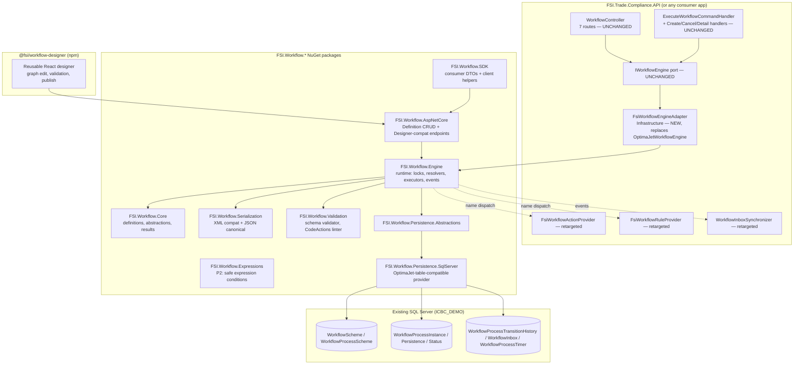
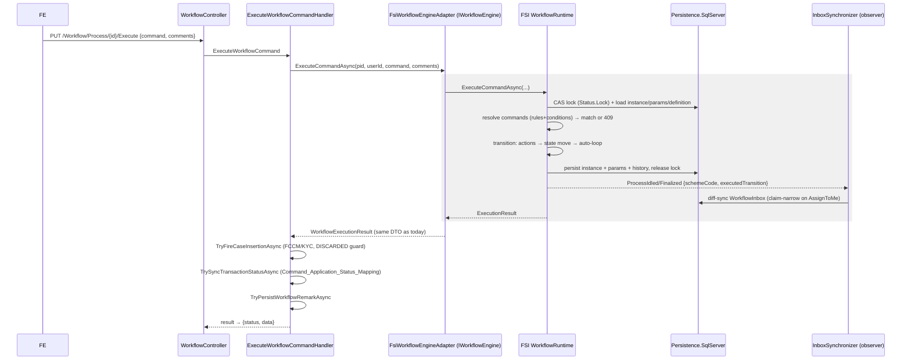
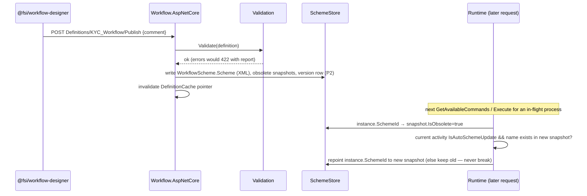
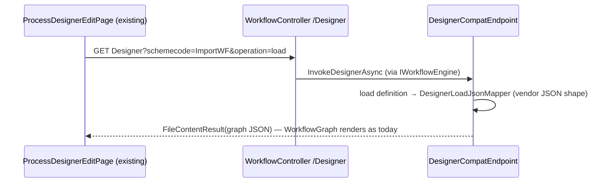

# FSI Workflow Engine — OptimaJet Replacement Implementation Plan

**Status**: 📐 Plan for approval — no code written yet.
**Date**: 2026-07-08
**Owner**: BE/FE full-stack agent
**Decisions locked with FSI**: (1) drop-in persistence on the existing `Workflow*` tables (zero data migration, in-flight processes survive cutover); (2) the designer ships as a **new reusable Workflow.UI package** (its own phase).
**Supersedes**: the "Replace OptimaJet runtime with an FSI-owned workflow engine" sketch in `BACKLOG.md` (this is that item, planned in full). Complements `docs/OPTIMAJET_POC.md` (the 3.5.0 pin research).

---

## Table of contents

1. [Executive summary & recommendation](#1-executive-summary)
2. [Current-state analysis — what OptimaJet does for us today](#2-current-state)
3. [Feature parity matrix](#3-feature-parity-matrix)
4. [Target architecture](#4-target-architecture)
5. [Project structure](#5-project-structure)
6. [Core component design](#6-core-components)
7. [Workflow schema model (definitions)](#7-schema-model)
8. [Runtime execution engine](#8-runtime-engine)
9. [Rule / condition / action providers](#9-rule-condition-engine)
10. [Persistence layer](#10-persistence)
11. [Serialization (XML compat + JSON canonical)](#11-serialization)
12. [Caching strategy](#12-caching)
13. [Concurrency handling](#13-concurrency)
14. [Scheme versioning & in-flight upgrade](#14-versioning)
15. [DI & extensibility](#15-di-extensibility)
16. [Logging & auditing](#16-logging-auditing)
17. [Exception handling & recovery](#17-exceptions)
18. [API design](#18-api-design)
19. [Workflow.UI designer package](#19-designer-ui)
20. [Backward compatibility / adapter layer](#20-adapter)
21. [Sequence diagrams](#21-sequences)
22. [Testing strategy](#22-testing)
23. [Migration roadmap & phases](#23-roadmap)
24. [Rollback strategy](#24-rollback)
25. [Risks & mitigations](#25-risks)
26. [DLL vs standalone service — trade-offs](#26-dll-vs-service)
27. [Open items to confirm during Phase 0](#27-open-items)

---

<a id="1-executive-summary"></a>
## 1. Executive summary & recommendation

We replace `WorkflowEngine.NETCore-Core 3.5.0` + `WorkflowEngine.NETCore-ProviderForMSSQL 3.5.0` with an FSI-owned engine, delivered as a **suite of .NET 8 class libraries (NuGet DLLs), hosted in-process** — not a separate network service (§26 has the full trade-off analysis). The engine:

- Reads/writes the **existing OptimaJet tables unchanged** (`WorkflowScheme`, `WorkflowProcessScheme`, `WorkflowProcessInstance`, `WorkflowProcessInstancePersistence`, `WorkflowProcessInstanceStatus`, `WorkflowProcessTransitionHistory`, `WorkflowInbox`, `WorkflowProcessTimer`, `WorkflowGlobalParameter`) via a pluggable persistence provider. **No data migration; in-flight processes continue mid-state.**
- Parses the **existing scheme XML format** natively (all 8 production schemes: `ImportWF`, `ExportWF`, `TradeWF`, `KYC_Workflow`, `CDAOScheme`, `KTWF`, `Advance`, `HsCode_Price_WF`) and adds a canonical **JSON definition format** with lossless XML⇄JSON round-trip.
- Slots in **behind the existing `IWorkflowEngine` Application port** — the 6 consumer call sites (`WorkflowController`, `ExecuteWorkflowCommandHandler`, `CreateTransactionCommandHandler`, `CancelTransactionCommandHandler`, `GetTransactionByIdQueryHandler`, `KycReviewOrchestrator`) do **not change**. Cutover is one DI line behind a config flag; rollback is flipping the flag back.
- Re-hosts the existing `FsiWorkflowActionProvider` (22 actions), `FsiWorkflowRuleProvider` (3 rules), and `WorkflowInboxSynchronizer` against engine-owned interfaces with the **same method shapes**, so those files change mechanically (interface `using`s), not logically.
- **Deliberately refuses to execute `<CodeActions>`** (Roslyn-compiled inline code) — the exact mechanism that caused the UAT KYC outage. The validator flags them; a lint/strip tool (built from the UAT fix toolkit) removes them. All 8 production schemes are already clean.

**Strategic wins**: removes the expired-license exposure (v3.x key expired 2020-07-24), removes an EOL unpatched dependency, removes the Windows-only pin (`ImportWindowsDesktopTargets` + `System.Data.SqlClient 4.8.1`) so Linux hosting becomes possible, and gives every tier of the modular-monolith plan a license-free workflow module.

**Estimated path to production cutover: ~7–9 weeks** (engine + compat + parity testing + shadow validation), with the reusable designer UI as a further ~3–4 week phase that can run in parallel after the API stabilises. Detail in §23.

---

<a id="2-current-state"></a>
## 2. Current-state analysis — what OptimaJet does for us today

Everything below was verified against code on 2026-07-08. This is the complete inventory of vendor surface that must be replaced.

### 2.1 Packages & bootstrap

| Item | Fact |
|---|---|
| Packages | `WorkflowEngine.NETCore-Core 3.5.0`, `WorkflowEngine.NETCore-ProviderForMSSQL 3.5.0` (in `FSI.Trade.Compliance.Infrastructure.csproj`) |
| Forced pins caused by OptimaJet | `Microsoft.Extensions.DependencyInjection.Abstractions 8.0.2`, `System.Data.SqlClient 4.8.1`, `System.Configuration.ConfigurationManager 8.0.0`, `<ImportWindowsDesktopTargets>true</ImportWindowsDesktopTargets>` (Windows-only host) |
| Bootstrap | `WorkflowRuntimeFactory` — singleton `Lazy<WorkflowRuntime>`: `RegisterLicense` (soft-fail) → `MSSQLProvider` ×2 (scheme + runtime persistence) → `WorkflowBuilder<XElement>(…, XmlWorkflowParser(), …).WithDefaultCache()` → `new WorkflowRuntime(RuntimeId)` `.WithBuilder().WithActionProvider().WithRuleProvider().WithPersistenceProvider().WithTimerManager(new TimerManager()).WithBus(new NullBus()).SwitchAutoUpdateSchemeBeforeGetAvailableCommandsOn().RegisterAssemblyForCodeActions(…)` → subscribe `ProcessStatusChanged` → `Start()` |
| RuntimeId | Hard-pinned GUID `8D38DB8F-F3D5-4F26-A989-4FDD40F32D9D` (legacy parity so existing instance rows resolve) |
| Multi-node | `WorkflowRuntime` coordination table is **not deployed** in ICBC_DEMO → single-runtime operation today |

### 2.2 Vendor API calls actually used (the entire surface to replicate)

`OptimaJetWorkflowEngine` (implements `IWorkflowEngine`, Scoped) calls exactly these runtime members:

| Vendor call | Used by | Purpose |
|---|---|---|
| `CreateInstanceAsync(CreateInstanceParams)` | `CreateInstanceAsync` | New process at initial activity (`IdentityId`/`ImpersonatedIdentityId`; defensive `InitialProcessParameters` init) |
| `GetAvailableCommandsAsync(processId, identityId)` | `ExecuteCommandAsync`, `GetAvailableCommandsAsync` | Command resolution (restriction rules + conditions) |
| `ExecuteCommandAsync(cmd, identityId, impersonatedIdentityId)` | `ExecuteCommandAsync` | Transition execution |
| `GetCurrentState(processId)` / `GetCurrentActivityName(processId)` | execute + detail read | State/activity reads |
| `SetState(processId, identity, impersonated, state, params)` | `SetStateAsync` | Forced state jump (cancel path; positional v3.5 API) |
| `GetProcessInstanceAndFillProcessParameters(processId)` | `TryDetermineIsFinalised` | SchemeCode for finalisation check |
| `Builder.GetProcessScheme(schemeCode)` → `ProcessDefinition.Activities[].IsFinal` | `TryDetermineIsFinalised` | Is the new state final? |
| `DesignerAPI(pars, stream, true)` | `InvokeDesignerAsync` | Designer JSON (FE calls **`operation=load` only**) |
| `GetAllActorsForCommandTransitions(...)` / `GetAllActorsForDirectCommandTransitions(...)` | `WorkflowInboxSynchronizer` | Inbox actor resolution after transition |
| `GetProcessInstancesTree(processId)` / `DeleteInstance(...)` | `KillSubProcesses` action | Sub-process cleanup |
| `GetProcessHistory(processId)` | `CurrentActivityExecuted`, `AppDelayWithWF` conditions | History reads |
| `IsProcessExists(processId)` | inbox synchronizer guard | Existence check |
| `ProcessStatusChanged` event (`Idled`/`Finalized`, `ExecutedTransition`, `SchemeCode`, `ProcessInstance`) | inbox synchronizer | The one engine event we consume |
| `pi.GetParameter<T>` / `pi.SetParameter(..., ParameterPurpose.Persistence)` | actions | Process parameter bag (`Approvers`, `SetStateVariable`, saved state names) |

Command DTO mapping consumed today: `CommandName`, `LocalizedName`, `Classifier` (enum→string), first parameter name, scheme-declared `IsDeviation` / `ManualActors` parameter default values.

### 2.3 Extension code we own already (ports to the new engine)

- **Actions — 22 registered** in `FsiWorkflowActionProvider`. Real (8): `SaveCurrentStateInParameter`, `ResetToStateByParameter`, `KillSubProcesses`, `FillAllUsersBucket`, `FillApprovers`, `Approve`, `ClearInboxByRole`, `UpdateApplicationCreatorByCommand`. Fail-safe no-ops (14): 8 DLP notification actions + 6 loan-app actions (Bucket C, Slice 8 backlog).
- **Conditions — 13 registered.** Real (7): `IsApproveComplete`, `CurrentActivityExecuted`, `AppDelayWithWF`, `RoleExists` (creator-location-hierarchy check), `RoleExistsInBranch`, `AppDelay`, `CheckCreatorRole`. No-ops (6): loan-slab/deviation conditions (`PendingApprovals`, `RoleAmountSlabs`, `IsAmountInActorSlab`, `CheckWFDeviation`, `IsAppAttached`, `checkSecondApprovalRequiredForNoGuarantor`).
- **Rules — 3** in `FsiWorkflowRuleProvider`: `IsCreator` (transaction creator by `ProcessInstanceId`), `CheckRole` (inbox membership **AND** role name), `Boss` (inbox membership only — legacy chain not ported). Both `Check` and `GetIdentities` directions.
- **`WorkflowInboxSynchronizer`** — on `ProcessStatusChanged(Idled|Finalized)`: `Finalized` → drop all `WorkflowInbox` rows; `Idled` → resolve actors for the new activity, **claim-narrow** to the executing user when the command ∈ `{"AssignToMe"}`, then diff-sync `WorkflowInbox`.
- All exception handling in providers is **catch-log-continue** (never breaks the transition) — a behavioural contract to preserve.

### 2.4 Scheme XML anatomy (from production `KYC_Workflow`; representative of all 8)

Root `<Process>` containing: `<Designer>` (X/Y layout metadata), `<Actors>` (Name + Rule + Value, e.g. `CheckRole`/`Authorizer KYC`), `<Commands>` (bare names; `InputParameters` supported by format, unused in KYC), `<Activities>` (Name, State, `IsInitial`, `IsFinal`, `IsForSetState`, `IsAutoSchemeUpdate`, optional `<Implementation>` `ActionRef Order=n NameRef=… + ActionParameter CDATA`; `PreExecutionImplementation` supported, unused in KYC), `<Transitions>` (From→To, `Classifier` Direct/Reverse, `<Restrictions>` Allow-by-actor, `<Triggers>` Command | Auto, `<Conditions>` Always | `Type="Action" NameRef=… ConditionInversion=…`, concatenation attributes, `IsFork`, `MergeViaSetState`, `DisableParentStateControl`). Timers, `<Parameters>`, Localization, fork=true: **present in the format, absent from all live schemes**. `<CodeActions>`: present only in the contaminated legacy KYC scheme (the UAT 500 root cause) — **must never execute** in the new engine.

### 2.5 The application contract that must not move

`IWorkflowEngine` (Application/Contracts/Workflow) — 6 methods: `CreateInstanceAsync`, `ExecuteCommandAsync` (→ `WorkflowExecutionResult { ProcessId, WasExecuted, PreviousState, CurrentState, Comment, IsFinalised }`), `SetStateAsync`, `GetAvailableCommandsAsync` (→ `WorkflowCommand { Name, VisibleName, Classifier, ParameterName, IsDeviation, ReceivingActors }`), `GetCurrentActivityNameAsync`, `InvokeDesignerAsync`. Behavioural contracts riding on it: `ConflictException("workflow_command_unavailable")` on unknown command (HTTP 409), fail-safe-`false` finalisation check, `Comments` parameter overlay, identity as **string** end-to-end (`Guid.TryParse` only at the `WorkflowInbox.IdentityId` boundary).

HTTP surface (7 routes on `WorkflowController`, all consumed by the FE): `GET Inbox`, `GET Process/{id}/Commands`, `PUT Process/{id}/Execute`, `GET Schemes`, `GET+POST ProductMapping`, `GET/POST Designer`. `Inbox`/`Schemes`/`ProductMapping` handlers read the DB directly (not the engine) — they keep working untouched because the tables don't change.

Orchestration above the engine (unchanged by this project): `ExecuteWorkflowCommandHandler` = engine execute → FCCM/KYC case post-hooks (`TryFireCaseInsertionAsync`, DISCARDED-guard) → status sync via `Command_Application_Status_Mapping` (`TrySyncTransactionStatusAsync`) → `ApplicationRemark` persistence.

---

<a id="3-feature-parity-matrix"></a>
## 3. Feature parity matrix

Phases: **P1** = required for cutover (used in production today) · **P2** = required by FSI requirements, not currently exercised (build after cutover, before designer GA) · **P3** = future/optional.

| # | OptimaJet feature | Used today? | Proposed implementation | Phase |
|---|---|---|---|---|
| 1 | Scheme XML parse (`XmlWorkflowParser`) | ✅ 8 schemes | `Fsi.Workflow.Serialization.XmlSchemeReader` — same element/attribute set, lossless | P1 |
| 2 | Activities (Initial/Final/ForSetState/AutoSchemeUpdate) | ✅ | `ActivityDefinition` in Core model | P1 |
| 3 | Transitions (Direct/Reverse, restrictions, triggers, conditions, concatenation) | ✅ | `TransitionDefinition` + `TransitionResolver` | P1 |
| 4 | Commands (+ localized name, classifier) | ✅ | `CommandDefinition` + command resolution pipeline | P1 |
| 5 | Actors + rule providers (`IsCreator`/`CheckRole`/`Boss`) | ✅ | `IWorkflowRuleProvider` (engine-owned, same shape: `Check`/`GetIdentities`) | P1 |
| 6 | Activity Implementation actions (`FillAllUsersBucket` etc., ordered, CDATA param) | ✅ | `IWorkflowActionProvider` (engine-owned) + `ActionExecutor` (catch-log-continue) | P1 |
| 7 | Condition actions (`CurrentActivityExecuted` etc., `ConditionInversion`) | ✅ | `IWorkflowConditionProvider` + `ConditionEvaluator` | P1 |
| 8 | Auto (triggerless) transitions loop | ✅ (KYC `CommonInboxActivity→AuthorizerActivity`) | Runtime auto-advance loop after each transition until quiescent | P1 |
| 9 | Process parameters w/ `ParameterPurpose.Persistence` (`Approvers`, `SetStateVariable`) | ✅ | `ParameterBag` → `WorkflowProcessInstancePersistence` provider (same serialization) | P1 |
| 10 | `SetState` (forced jump; `IsForSetState` flag) | ✅ (cancel path) | `SetStateAsync` honouring `IsForSetState` + history row | P1 |
| 11 | Process status + lock (`WorkflowProcessInstanceStatus` tinyint + Lock guid) | ✅ | Same table, CAS-based `ProcessLock` (§13) — tinyint values verified in Phase 0 | P1 |
| 12 | Transition history (all 11 columns incl. `TriggerName`, `IsFinalised`) | ✅ (audit + stepper + inbox logic) | `HistoryWriter` — byte-compatible rows | P1 |
| 13 | `ProcessStatusChanged` event → inbox sync | ✅ | `IProcessEventObserver` with equivalent payload; synchronizer re-targeted mechanically | P1 |
| 14 | Actor enumeration (`GetAllActorsFor[Direct]CommandTransitions`) | ✅ | Engine query APIs with identical semantics | P1 |
| 15 | Scheme snapshots + `IsObsolete` + upgrade-on-idle (`SwitchAutoUpdateSchemeBeforeGetAvailableCommands`, `IsAutoSchemeUpdate`) | ✅ (26 snapshots live) | Same snapshot model on `WorkflowProcessScheme`; upgrade check before command resolution (§14) | P1 |
| 16 | Process tree (`RootProcessId`/`ParentProcessId`, `GetProcessInstancesTree`, `DeleteInstance`) | ✅ (`KillSubProcesses`, root-join in inbox) | Tree columns honoured; tree read + cascade delete | P1 |
| 17 | Designer API `operation=load` (graph JSON) | ✅ (FE read-only graph) | `DesignerCompatEndpoint` emitting the same JSON shape | P1 |
| 18 | Scheme upload/save via Designer API | ⚠️ not wired in FE today | New first-class Definition CRUD API (JSON + XML import) — replaces, not emulates | P2 |
| 19 | `<CodeActions>` (Roslyn inline code) | ❌ (production schemes clean; caused UAT outage) | **Refused by design.** Validator error + `strip` tool. Named providers are the only extension path (compliance/audit parity with the Auto-Flags registry decision) | Never |
| 20 | Timers (`WorkflowProcessTimer`, timer triggers) | ❌ table empty-use | `ITimerScheduler` abstraction in P1 (no-op); `HostedTimerScheduler` (BackgroundService polling the same table) | P2 |
| 21 | Parallel branches (`IsFork`, `MergeViaSetState`) | ❌ (all false) | Parsed + validated-reject in P1; fork/join execution | P3 |
| 22 | Sub-workflow spawning | ❌ (only kill/tree used) | Tree already supported; spawn semantics | P3 |
| 23 | Localization block | ❌ | Parse-preserve in P1; designer editing | P3 |
| 24 | `WorkflowGlobalParameter` store | ❌ (zero code refs) | Provider API exists (table already there); no consumer | P3 |
| 25 | Command `InputParameters` | ⚠️ format-only | Parsed in P1 (present in model); designer editing in P2 | P1/P2 |
| 26 | Distributed multi-runtime coordination | ❌ (`WorkflowRuntime` table absent) | Single-node w/ DB CAS lock in P1; `IDistributedLockProvider` seam for scale-out | P3 |
| 27 | License management | ✅ (expired key!) | **Eliminated** — no license concept | P1 |

---

<a id="4-target-architecture"></a>
## 4. Target architecture



Principles: Clean Architecture (Core has zero dependencies; Engine depends only on Core + Persistence.Abstractions), SOLID, everything injectable, no statics except immutable parsed definitions, `async` end-to-end with `CancellationToken`, thread-safe by design (§13), DB-agnostic behind `Persistence.Abstractions`.

---

<a id="5-project-structure"></a>
## 5. Project structure

New solution folder `Workflow/` inside the `FSI.Trade.Compliance` repo initially (extraction to its own repo/feed when a second consumer app appears — the code is structured for that from day 1). Mapping to the requested names:

| Requested | Actual project | Responsibility | Key contents |
|---|---|---|---|
| Workflow.Core | `FSI.Workflow.Core` | Definition model, abstractions, results, events. **Zero deps.** | `ProcessDefinition`, `ActivityDefinition`, `TransitionDefinition`, `CommandDefinition`, `ActorDefinition`, `ConditionDefinition`, `TimerDefinition`, `ParameterDefinition`; `IWorkflowRuntime`, `IWorkflowActionProvider`, `IWorkflowRuleProvider`, `IWorkflowConditionProvider`, `IProcessEventObserver`, `ITimerScheduler`; `ProcessStatus`, `TransitionClassifier`, `ExecutionResult`, `CommandDescriptor`, `ProcessActivityContext`; typed exceptions |
| Workflow.Engine | `FSI.Workflow.Engine` | Runtime execution | `WorkflowRuntime` (impl), `CommandResolver`, `TransitionResolver`, `ConditionEvaluator`, `ActionExecutor`, `RuleGate`, `SetStateExecutor`, `AutoTransitionLoop`, `SchemeUpgrader`, `ProcessLock`, `HistoryWriter`, `EventDispatcher`, `DefinitionCache` |
| Workflow.Persistence | `FSI.Workflow.Persistence.Abstractions` + `FSI.Workflow.Persistence.SqlServer` | Storage ports + the OptimaJet-table-compatible provider (EF Core 8; provider-agnostic LINQ, SQL-Server-tested) | `ISchemeStore`, `IProcessInstanceStore`, `IProcessStatusStore`, `IParameterStore`, `IHistoryStore`, `IInboxStore`, `ITimerStore`, `IGlobalParameterStore`; `OptimaJetCompatDbContext` + per-table mappings incl. deployment quirks |
| Workflow.Expressions | `FSI.Workflow.Expressions` (P2) | Safe, non-Roslyn expression conditions/assignments over parameters (`amount > threshold`) | Tokenizer/parser/evaluator, whitelisted functions; **no arbitrary code** |
| Workflow.Validation | `FSI.Workflow.Validation` | Definition validation + linting | Structural rules (unreachable activity, missing action/rule/command refs, duplicate names, no-initial/no-final, fork-not-supported), **CodeActions detector**, provider-registry cross-check, warning/error severities |
| Workflow.API | `FSI.Workflow.AspNetCore` | Optional endpoint package for hosts | Definition CRUD endpoints, validate/publish, versions, Designer-compat (`operation=load`), DI extensions (`AddFsiWorkflow`, `MapFsiWorkflowApi`) |
| Workflow.UI | `@fsi/workflow-designer` (npm, separate `workflow-designer/` folder) | Reusable React designer (§19) | Graph editor, inspectors, validation surfacing, publish flow; embeddable component + standalone shell |
| Workflow.Adapters | `FSI.Workflow.Adapters.OptimaJet` | Everything vendor-shaped | `XmlSchemeReader`/`XmlSchemeWriter` (OptimaJet dialect), `DesignerLoadJsonMapper` (graph JSON shape the FE `WorkflowGraph` already parses), `CodeActionsLinter`/`Stripper`, status-value mapping constants |
| Workflow.SDK | `FSI.Workflow.SDK` | For future external consumers of the hosted API | Typed client over Workflow.API routes, DTOs shared with `@fsi/workflow-designer` |
| — | `FSI.Workflow.Testing` | Parity + test infra | `ParityHarness` (OptimaJet vs FSI diff runner), in-memory persistence provider, scheme fixtures (8 production schemes), builders |

Host-side additions (in `FSI.Trade.Compliance.Infrastructure`): `Workflow/Fsi/FsiWorkflowEngineAdapter.cs` (implements the existing `IWorkflowEngine`), thin provider shims, DI flag wiring. **No changes** in Application or API layers beyond DI registration.

---

<a id="6-core-components"></a>
## 6. Core component design

### 6.1 Component responsibilities

| Component | Responsibility (single) |
|---|---|
| `WorkflowRuntime` (engine facade) | Orchestrates: load definition + instance → lock → resolve → execute → persist → events. The only public entry point. |
| `DefinitionCache` | Parsed, immutable `ProcessDefinition` per `SchemeId` (§12). |
| `SchemeUpgrader` | Obsolete-snapshot check + in-flight upgrade when activity `IsAutoSchemeUpdate` (§14). |
| `CommandResolver` | For (process, identity): current activity → outgoing command-triggered transitions → restriction gate (`RuleGate`) → condition gate → distinct `CommandDescriptor`s. |
| `RuleGate` | Evaluates transition `Restrictions` (Allow/Deny, And/Or concat) by resolving Actor → rule provider `Check`; reverse direction via `GetIdentities` for actor enumeration APIs. |
| `ConditionEvaluator` | `Always` / `Action`(+`ConditionInversion`) / (P2) `Expression`; honours `ConditionsConcatenationType`. |
| `TransitionExecutor` | Applies one transition: pre-execution implementation → state/activity mutation (incl. `PreviousStateForDirect/Reverse` bookkeeping per classifier) → activity `Implementation` actions in `Order` → history row → parameter persistence. |
| `AutoTransitionLoop` | After any executed transition, repeatedly resolve Auto-triggered transitions whose conditions pass; execute until quiescent or final. Loop guard: max-iterations + cycle detection. |
| `ActionExecutor` | Name-dispatch to registered `IWorkflowActionProvider`s; catch-log-continue per action (strict mode configurable). |
| `SetStateExecutor` | Forced jump to activity by state name (must exist + `IsForSetState`); history row with `TriggerName="SetState"`; parameters overlay (`Comments`). |
| `ProcessLock` | Per-process mutual exclusion: in-proc keyed semaphore + DB CAS on `WorkflowProcessInstanceStatus.Lock` (§13). |
| `HistoryWriter` | Byte-compatible `WorkflowProcessTransitionHistory` rows (all 11 columns). |
| `EventDispatcher` | Sync-ordered dispatch to `IProcessEventObserver`s (`ProcessIdled`, `ProcessFinalized`, `TransitionExecuted`, `ProcessCreated`, `StateSet`); observer exceptions logged, never thrown (inbox-sync parity). |
| `ITimerScheduler` | P1: validate-reject timer triggers + no-op scheduler. P2: hosted poller on `WorkflowProcessTimer`. |

### 6.2 Class diagram (Core + Engine, key types)

```mermaid
classDiagram
    class ProcessDefinition {
        +string SchemeCode
        +Guid SchemeId
        +IReadOnlyList~ActorDefinition~ Actors
        +IReadOnlyList~CommandDefinition~ Commands
        +IReadOnlyList~ParameterDefinition~ Parameters
        +IReadOnlyList~ActivityDefinition~ Activities
        +IReadOnlyList~TransitionDefinition~ Transitions
        +IReadOnlyList~TimerDefinition~ Timers
        +ActivityDefinition InitialActivity()
        +ActivityDefinition FindByState(string)
        +IReadOnlyList~TransitionDefinition~ From(string activity)
    }
    class ActivityDefinition {
        +string Name
        +string State
        +bool IsInitial
        +bool IsFinal
        +bool IsForSetState
        +bool IsAutoSchemeUpdate
        +IReadOnlyList~ActionRef~ Implementation
        +IReadOnlyList~ActionRef~ PreExecutionImplementation
        +DesignerMeta Designer
    }
    class TransitionDefinition {
        +string Name
        +string FromActivity
        +string ToActivity
        +TransitionClassifier Classifier
        +TriggerDefinition Trigger
        +IReadOnlyList~RestrictionDefinition~ Restrictions
        +IReadOnlyList~ConditionDefinition~ Conditions
        +ConcatenationType AllowConcatenation
        +ConcatenationType RestrictConcatenation
        +ConcatenationType ConditionsConcatenation
        +bool IsFork
        +bool MergeViaSetState
        +bool DisableParentStateControl
    }
    class TriggerDefinition {
        +TriggerType Type  // Command|Auto|Timer
        +string NameRef
    }
    class ConditionDefinition {
        +ConditionType Type  // Always|Action|Otherwise|Expression(P2)
        +string NameRef
        +string Parameter
        +bool Inversion
    }
    class RestrictionDefinition {
        +RestrictionType Type  // Allow|Deny
        +string ActorName
    }
    class ActorDefinition {
        +string Name
        +string Rule
        +string Value
    }
    class CommandDefinition {
        +string Name
        +string LocalizedName
        +IReadOnlyList~CommandParameter~ InputParameters
    }
    class ActionRef {
        +int Order
        +string NameRef
        +string Parameter
    }
    class IWorkflowRuntime {
        <<interface>>
        +CreateInstanceAsync(schemeCode, processId, identity, params, ct)
        +ExecuteCommandAsync(processId, identity, command, params, ct) ExecutionResult
        +SetStateAsync(processId, identity, state, params, ct)
        +GetAvailableCommandsAsync(processId, identity, ct) IReadOnlyList~CommandDescriptor~
        +GetCurrentActivityAsync(processId, ct) ProcessActivityContext
        +GetActorsForNextTransitionsAsync(processId, directOnly, ct) IReadOnlyList~string~
        +GetProcessTreeAsync(processId, ct)
        +DeleteInstanceAsync(processId, ct)
        +GetHistoryAsync(processId, ct)
        +IsProcessExistsAsync(processId, ct) bool
    }
    class WorkflowRuntime {
        -ISchemeStore schemes
        -IProcessInstanceStore instances
        -IProcessStatusStore status
        -IParameterStore parameters
        -IHistoryStore history
        -ProcessLock locks
        -DefinitionCache cache
        -CommandResolver commands
        -TransitionExecutor executor
        -EventDispatcher events
    }
    class IWorkflowActionProvider {
        <<interface>>
        +IReadOnlyList~string~ ActionNames
        +ExecuteActionAsync(name, ProcessContext, parameter, ct)
    }
    class IWorkflowConditionProvider {
        <<interface>>
        +IReadOnlyList~string~ ConditionNames
        +EvaluateAsync(name, ProcessContext, parameter, ct) bool
    }
    class IWorkflowRuleProvider {
        <<interface>>
        +IReadOnlyList~string~ RuleNames
        +CheckAsync(ProcessContext, identityId, rule, parameter, ct) bool
        +GetIdentitiesAsync(ProcessContext, rule, parameter, ct) IReadOnlyList~string~
    }
    class ProcessContext {
        +Guid ProcessId
        +Guid RootProcessId
        +string SchemeCode
        +string CurrentActivity
        +string CurrentState
        +string IdentityId
        +string ExecutedCommand
        +ParameterBag Parameters
    }
    ProcessDefinition *-- ActivityDefinition
    ProcessDefinition *-- TransitionDefinition
    ProcessDefinition *-- ActorDefinition
    ProcessDefinition *-- CommandDefinition
    TransitionDefinition *-- TriggerDefinition
    TransitionDefinition *-- ConditionDefinition
    TransitionDefinition *-- RestrictionDefinition
    ActivityDefinition *-- ActionRef
    WorkflowRuntime ..|> IWorkflowRuntime
    WorkflowRuntime --> IWorkflowActionProvider
    WorkflowRuntime --> IWorkflowConditionProvider
    WorkflowRuntime --> IWorkflowRuleProvider
```



---

<a id="7-schema-model"></a>
## 7. Workflow schema model (definitions)

Two on-disk representations, one in-memory model:

1. **XML (OptimaJet dialect)** — the compatibility format. Reader/writer in `Adapters.OptimaJet` covers every element/attribute inventoried in §2.4, including ones live schemes don't use (Parameters, InputParameters, Timers, Localization, fork attributes) so round-trip is lossless. Unknown elements are preserved in an `Extensions` bag (forward-compat), except `<CodeActions>` which parses into a quarantine node that validation flags.
2. **JSON (canonical, new)** — `System.Text.Json`, camelCase, versioned envelope:

```jsonc
{
  "formatVersion": 1,
  "schemeCode": "KYC_Workflow",
  "actors":   [ { "name": "Authorizer KYC", "rule": "CheckRole", "value": "Authorizer KYC" } ],
  "commands": [ { "name": "SendToAuthorizer", "localizedName": "Send To Authorizer", "inputParameters": [] } ],
  "parameters": [],
  "activities": [
    { "name": "AnalystActivity", "state": "AnalystActivity",
      "isInitial": true, "isFinal": false, "isForSetState": true, "isAutoSchemeUpdate": true,
      "implementation": [ { "order": 1, "actionRef": "FillAllUsersBucket", "parameter": "Authorizer KYC" } ],
      "designer": { "x": 120, "y": 80 } }
  ],
  "transitions": [
    { "name": "AnalystActivity_CommonInbox_1", "from": "AnalystActivity", "to": "CommonInboxActivity",
      "classifier": "Direct",
      "trigger": { "type": "Command", "nameRef": "SendToAuthorizer" },
      "restrictions": [ { "type": "Allow", "actor": "Analyst KYC" } ],
      "conditions": [ { "type": "Always" } ],
      "concatenation": { "allow": "And", "restrict": "And", "conditions": "And" },
      "isFork": false, "mergeViaSetState": false, "disableParentStateControl": false }
  ],
  "timers": [],
  "localization": []
}
```

Rules: the JSON and XML forms are **projections of the same `ProcessDefinition`**; `XmlSchemeReader.Read(xml) |> JsonSchemeWriter.Write` and the inverse are tested against all 8 production schemes byte-semantically (attribute defaults normalised). The DB keeps storing XML in `WorkflowScheme.Scheme` / `WorkflowProcessScheme.Scheme` during P1 (drop-in constraint); the Definition API (§18) accepts/returns both, converting at the edge. A later opt-in (P3) can store JSON once OptimaJet is fully retired.

Validation model (`FSI.Workflow.Validation`) runs on load and on publish: **errors** (block publish/execute) — no initial activity, >1 initial, unknown `ActionRef`/`NameRef`/actor/command reference, transition from/to unknown activity, duplicate activity/command names, `IsFork=true` (until P3), timer trigger without scheduler enabled, **any `<CodeActions>` content**; **warnings** — unreachable activity, final activity with outgoing transitions, command declared but never triggered (KYC's `Done`/`CheckBlacklist` pattern — warning only, since production schemes do this), actor declared but unused, no path from initial to any final.

---

<a id="8-runtime-engine"></a>
## 8. Runtime execution engine

### 8.1 Process status model

Persisted in `WorkflowProcessInstanceStatus.Status` (tinyint) — **the compat provider must write the exact numeric values OptimaJet uses** so mixed-era rows stay interpretable. Engine enum:

| FSI enum | Meaning | tinyint |
|---|---|---|
| `Initialized` | Created, never run | *verify in Phase 0 (expected 0)* |
| `Running` | A transition is executing (lock held) | *verify (expected 1)* |
| `Idled` | Waiting at an activity | *verify (expected 2)* |
| `Finalized` | Reached `IsFinal` activity | *verify (expected 3)* |
| `Terminated` | Deleted/killed | *verify (expected 4)* |
| `Error` | Faulted mid-transition | *verify (expected 5)* |

Phase 0 verifies the mapping empirically from ICBC_DEMO rows + vendor persistence source (the provider SQL is inspectable) and locks it in `Adapters.OptimaJet.StatusValueMap` with a unit test asserting live-DB samples.

### 8.2 ExecuteCommand pipeline (the core algorithm)

```
ExecuteCommandAsync(processId, identityId, commandName, parameters):
 1. acquire ProcessLock(processId)                         (§13; CAS on Status.Lock, status→Running)
 2. load instance (WorkflowProcessInstance) + parameters (Persistence rows → ParameterBag)
 3. resolve definition: SchemeId → DefinitionCache; SchemeUpgrader.MaybeUpgrade(instance, def)   (§14)
 4. CommandResolver.Resolve(def, instance, identityId):
      candidates = def.From(instance.ActivityName) where Trigger.Type==Command
      for each: RuleGate (restrictions: actor→rule.Check(identity)) AND ConditionEvaluator
      → distinct commands (first-transition-wins per command name, scheme order)
 5. match commandName (case-insensitive) → else throw CommandNotAvailableException
 6. TransitionExecutor.Execute(chosen):
      a. PreExecutionImplementation actions (ordered, catch-log-continue)
      b. record prev state/activity; per Classifier update PreviousState[ForDirect|ForReverse],
         PreviousActivity[…]; set ActivityName/StateName to target
      c. target activity Implementation actions (ordered; ProcessContext carries ExecutedCommand,
         IdentityId, ParameterBag)
      d. persist instance row + dirty parameters (Persistence purpose only)
      e. HistoryWriter.Append(from/to activity+state, classifier, TriggerName=commandName,
         Executor/ActorIdentityId, IsFinalised=target.IsFinal, TransitionTime=UtcNow)
 7. AutoTransitionLoop: while current activity has Auto-trigger transitions whose
    conditions pass (RuleGate NOT applied to Auto — parity: KYC auto transition has no
    restrictions; restriction handling for Auto follows OptimaJet semantics verified in
    parity tests) → execute step 6 for each; guard: max 32 iterations + visited-set.
 8. final status: target.IsFinal ? Finalized : Idled; release lock (CAS back, new Lock guid)
 9. EventDispatcher: TransitionExecuted(+each auto), then ProcessIdled | ProcessFinalized
    with { SchemeCode, ProcessInstance snapshot, ExecutedTransition(trigger command) } —
    the exact payload WorkflowInboxSynchronizer consumes today
10. return ExecutionResult { WasExecuted, PreviousState, CurrentState, IsFinalised }
```

`CreateInstanceAsync`: insert instance at initial activity (Status=Initialized→Idled), run initial activity `Implementation` actions? — **No**: parity note — OptimaJet does *not* run the initial activity's implementation on create (verified: `AnalystActivity` has none; ImportWF checked in Phase 0 parity run); events: `ProcessCreated` then `ProcessIdled`. `SetStateAsync`: validate target `IsForSetState`, write history with `TriggerName="SetState"` (the inbox history filter depends on this literal), run target implementation actions per OptimaJet semantics (verified in parity harness), fire `StateSet` + `ProcessIdled`/`ProcessFinalized`.

`GetAvailableCommandsAsync` = steps 1–4 read-only (no lock; snapshot read) + scheme-upgrade check first (`SwitchAutoUpdateSchemeBeforeGetAvailableCommandsOn` parity). Descriptor carries `Name`, `LocalizedName`, `Classifier`, `InputParameters[0]?.Name`, plus raw scheme parameter defaults so the adapter can surface `IsDeviation` / `ManualActors` exactly as today.

### 8.3 Timers (P2)

`ITimerScheduler` port in Core. P1 registers `NoopTimerScheduler` (+ validation error if a scheme declares timers). P2 ships `HostedTimerScheduler` — a `BackgroundService` polling `WorkflowProcessTimer` (same columns: `NextExecutionDateTime`, `Ignore`), firing timer-triggered transitions through the same pipeline with `identityId = "timer"`. Single-node safe via the same ProcessLock; multi-node needs `IDistributedLockProvider` (P3).

---

<a id="9-rule-condition-engine"></a>
## 9. Rule / condition / action providers

Engine-owned interfaces (Core), name-dispatch with **multiple registered providers** (first provider claiming a name wins; duplicate names across providers = startup error):

```csharp
public interface IWorkflowActionProvider {
    IReadOnlyList<string> ActionNames { get; }
    Task ExecuteActionAsync(string name, ProcessContext ctx, string? parameter, CancellationToken ct);
}
public interface IWorkflowConditionProvider {
    IReadOnlyList<string> ConditionNames { get; }
    Task<bool> EvaluateAsync(string name, ProcessContext ctx, string? parameter, CancellationToken ct);
}
public interface IWorkflowRuleProvider {
    IReadOnlyList<string> RuleNames { get; }
    Task<bool> CheckAsync(ProcessContext ctx, string identityId, string rule, string? parameter, CancellationToken ct);
    Task<IReadOnlyList<string>> GetIdentitiesAsync(ProcessContext ctx, string rule, string? parameter, CancellationToken ct);
}
```

Design decisions:

- **Same shapes as today's providers** → retargeting `FsiWorkflowActionProvider` / `FsiWorkflowRuleProvider` is a mechanical edit (swap vendor `ProcessInstance` for `ProcessContext`, drop vendor interface members like `IsActionAsync`). All 22 actions / 13 conditions / 3 rules port as-is, including the Bucket-C no-ops and catch-log-continue behaviour.
- `ProcessContext` exposes what the current providers actually consume: `ProcessId`, `RootProcessId`, `SchemeCode`, current activity/state, `ExecutedActivityName`, `CurrentCommand`, `IdentityId`, `ParameterBag` (typed get/set with persistence purpose), plus history access via an injected `IHistoryStore` (for `CurrentActivityExecuted` / `AppDelayWithWF`).
- **No Roslyn/CodeActions execution path exists at all** — the extension model is exclusively named providers registered in DI. This mirrors the Auto-Flags "registry, not DSL" decision and is what makes the UAT-class failure structurally impossible.
- **`FSI.Workflow.Expressions` (P2)**: a small, safe expression evaluator (comparison/boolean/arithmetic over `ProcessContext.Parameters` + whitelisted functions) usable as `ConditionDefinition.Type=Expression`. Explicitly not required for cutover; gives the designer a no-code condition option later.

---

<a id="10-persistence"></a>
## 10. Persistence layer

### 10.1 Ports (`FSI.Workflow.Persistence.Abstractions`)

`ISchemeStore` (master schemes + snapshots: `GetSnapshot(schemeId)`, `GetLatestSnapshot(schemeCode)` — creates from master if none current, `MarkObsolete(schemeCode)`, `SaveMaster(code, xml/json)`), `IProcessInstanceStore`, `IProcessStatusStore` (CAS: `TryAcquire(processId, oldLock, newLock, status)`), `IParameterStore`, `IHistoryStore`, `IInboxStore`, `ITimerStore`, `IGlobalParameterStore`. All async, all `CancellationToken`. DB-agnostic: nothing above Abstractions knows SQL Server exists.

### 10.2 Provider #1: `FSI.Workflow.Persistence.SqlServer` (OptimaJet-compatible, EF Core 8)

Maps the existing tables **exactly** (DDL verified against `ICBC_DEMO-Schema.sql`):

| Table | Columns (verified) | Compat notes |
|---|---|---|
| `WorkflowScheme` | `Code nvarchar(256) PK`, `Scheme nvarchar(max)` | Master XML per scheme code. `TmX_Workflow_VW` joins `TmX_Product.Workflow_Scheme_Code` → `Code` — untouched. |
| `WorkflowProcessScheme` | `Id PK`, `Scheme ntext`, `DefiningParameters ntext`, `DefiningParametersHash nvarchar(24)`, `SchemeCode`, `IsObsolete bit`, `RootSchemeCode`, `RootSchemeId`, `AllowedActivities`, `StartingTransition` | Snapshot store. Hash algorithm replicated from vendor (verify MD5-of-defining-params in Phase 0; live value for empty params captured as fixture). `ntext` mapped as string. |
| `WorkflowProcessInstance` | `Id PK`, `StateName`, `ActivityName`, `SchemeId`, `PreviousState(±ForDirect/ForReverse)`, `PreviousActivity(±…)`, `ParentProcessId`, `RootProcessId`, `IsDeterminingParametersChanged` | The classifier-specific Previous* bookkeeping is load-bearing (Reverse transitions) — executor maintains all six. |
| `WorkflowProcessInstancePersistence` | `Id PK`, `ProcessId`, `ParameterName`, `Value nvarchar(max)` | Parameter bag. **Serialization parity**: values written with the vendor's JSON conventions (verified against live `Approvers` rows in Phase 0) so old rows deserialize and mixed-era rows stay readable. |
| `WorkflowProcessInstanceStatus` | `Id PK clustered`, `Status tinyint`, `Lock uniqueidentifier` | The concurrency CAS target (§13). |
| `WorkflowProcessTransitionHistory` | `Id PK`, `ProcessId`, `ExecutorIdentityId nvarchar(256)`, `ActorIdentityId nvarchar(256)`, `FromActivityName`, `ToActivityName`, `FromStateName`, `ToStateName`, `TransitionTime datetime`, `TransitionClassifier`, `TriggerName`, `IsFinalised bit` | Consumed by `GetWorkflowHistory`, audit trail, `ListInbox` (`TriggerName != "SetState"` filter) — byte-compatible writes required. |
| `WorkflowInbox` | `Id PK`, `ProcessId`, `IdentityId uniqueidentifier` — **3 columns in this deployment** (`AvailableCommands`/`AddingDate` absent) | Engine never writes this table itself — it stays owned by the app's `WorkflowInboxSynchronizer` + actions, exactly as today. `IInboxStore` exists for engines hosted elsewhere; the FSI.Trade.Compliance host keeps its own EF path. |
| `WorkflowProcessTimer` | `Id PK`, `ProcessId`, `Name`, `NextExecutionDateTime`, `Ignore` | P2 scheduler. |
| `WorkflowGlobalParameter` | `Id PK`, `Type nvarchar(306)`, `Name nvarchar(128)`, `Value` | Port exists; no consumer. |

No new tables for P1. Additive-only extras later (all optional): `FSI_Workflow_Scheme_Version` (P2 version history, §14), `FSI_Workflow_RuntimeLock` (P3 multi-node). EF Core keeps the provider mostly DB-agnostic; SQL Server is the tested target; a second provider (e.g. PostgreSQL, or a greenfield JSON-native schema) implements the same ports later — that is the "database-agnostic" requirement satisfied at the port boundary, not by lowest-common-denominator SQL.

---

<a id="11-serialization"></a>
## 11. Serialization / deserialization

- `XmlSchemeReader` / `XmlSchemeWriter` (Adapters.OptimaJet): tolerant reader (attribute defaults per OptimaJet semantics: `IsFork=false`, concatenation `And`, `ConditionInversion=false`), CDATA-preserving `ActionParameter`, `<CodeActions>` → quarantine node (never compiled, never executed; carried through writes so a strip is an explicit operation, not silent data loss).
- `JsonSchemeReader/Writer` (Serialization): canonical camelCase model (§7), `formatVersion` gate for future evolution.
- `ParameterSerializer`: replicates vendor JSON for `WorkflowProcessInstancePersistence.Value` (Phase 0 captures live fixtures — `Approvers` dictionary shape `{"ApproversDictionary":{"<userId>":bool}}` already documented).
- `DesignerLoadJsonMapper` (Adapters.OptimaJet): emits the graph JSON shape the FE `WorkflowGraph.tsx` normaliser already parses for `Designer?operation=load` (activities + DesignerSettings X/Y + transitions + command labels). Contract captured as golden files from the live endpoint before cutover.
- Round-trip tests: all 8 production schemes XML→model→XML and XML→JSON→model→XML, semantic-equality assertions.

---

<a id="12-caching"></a>
## 12. Caching strategy

| Cache | Scope | Policy |
|---|---|---|
| `DefinitionCache` — parsed `ProcessDefinition` | keyed by `SchemeId` (snapshot GUID) | Immutable-forever entries (a snapshot never changes); LRU cap (default 128) — mirrors vendor `WithDefaultCache()` |
| Latest-snapshot pointer (`SchemeCode` → current `SchemeId`) | per scheme code | Invalidated on publish/`MarkObsolete`; short TTL (60 s) safety net for out-of-band DB edits (the UAT-fix scenario) + explicit `Invalidate(schemeCode)` on the Definition API write path |
| Process instance / status / parameters | none | Always read-through — correctness over speed; matches vendor and today's load profile (single-digit processes per request) |
| Command resolution | per-call only | Computed per request; no cross-request cache (identity- and state-dependent) |

Explicitly rejected: caching instances (stale-lock hazards), distributed cache (single-node deployment; revisit with P3 scale-out).

---

<a id="13-concurrency"></a>
## 13. Concurrency handling

- **Per-process mutual exclusion, two layers**: (1) in-proc `KeyedSemaphore(processId)` — cheap fast-path for the single-node reality; (2) **DB CAS** on `WorkflowProcessInstanceStatus`: `UPDATE … SET Status=Running, Lock=@new WHERE Id=@pid AND Lock=@old` (rowcount 1 = acquired). Both released in `finally`. Layer 2 makes a second host (accidental double-deploy, ops running a console tool) safe even before P3 multi-node work.
- Lock held across steps 2–8 of the pipeline; events (step 9) dispatch **after release** to keep observer work (inbox sync → EF SaveChanges) out of the critical section — same ordering the vendor exhibits (verified in parity harness).
- Contention behaviour: `ExecuteCommand` on a locked process waits up to `LockTimeout` (default 10 s) then throws `ProcessBusyException` → adapter maps to `ConflictException("workflow_process_busy")` (new, additive error code; FE toast handles 409s generically).
- **Stuck-lock recovery**: a process left `Running` with an expired wall-clock (crash mid-transition) is recoverable via `RuntimeJanitor` (startup + hourly): rows `Running` older than `StuckThreshold` (default 5 min) → reset to `Idled`, log ERROR with process id (the transition either committed its instance row or didn't — the pipeline orders instance-write before status-release, so reset is safe; documented invariant + test).
- Thread-safety: `ProcessDefinition` immutable; runtime services stateless; `ParameterBag` confined to the locked pipeline instance; `EventDispatcher` snapshots observer list.
- Idempotency: command execution is not idempotent by design (matches vendor); double-submit protection = the lock + command re-resolution (second attempt sees the new state and 409s with `workflow_command_unavailable` — today's exact behaviour).

---

<a id="14-versioning"></a>
## 14. Scheme versioning & in-flight upgrade

**P1 (compat parity)** — reproduce the OptimaJet model exactly, since 26 live snapshots depend on it:

- Master XML in `WorkflowScheme.Code/Scheme`. A process is created from the **latest snapshot** in `WorkflowProcessScheme` for that code (`IsObsolete=0`, matching `DefiningParametersHash`); if none, the engine materialises one from the master.
- Publishing a new master → mark existing snapshots `IsObsolete=1`. In-flight processes keep their old `SchemeId` (definitions are immutable per snapshot — old processes are never broken by a publish).
- **Upgrade-on-idle**: before command resolution (`SwitchAutoUpdateSchemeBeforeGetAvailableCommandsOn` parity), if the instance's snapshot `IsObsolete` and its current activity has `IsAutoSchemeUpdate=true` and an activity with the same name exists in the new snapshot → repoint `SchemeId` (+`IsDeterminingParametersChanged` bookkeeping). All four activities in the production KYC scheme set `IsAutoSchemeUpdate=true` (remaining 7 schemes confirmed during the Phase 0 XML export), so this path is hot and must be exact.
- `sub-scheme` fields (`RootSchemeCode/RootSchemeId/AllowedActivities/StartingTransition`) are read/written pass-through for tree processes; spawning new sub-processes is P3.

**P2 (first-class versioning, additive)** — `FSI_Workflow_Scheme_Version` table: `(SchemeCode, VersionNo, Definition (json), DefinitionXml, PublishedBy, PublishedAt, Comment, IsActive)`. The Definition API records every publish; `WorkflowScheme.Scheme` remains the "active version" projection so P1 compat and the vendor-era tables stay authoritative for execution. Gives the designer version history, diff, and rollback-to-version (= publish old body as new version). Migration between definition versions of *running* processes stays activity-name-based upgrade-on-idle (proven model); a forced `MigrateProcessesAsync(code, fromVersion, toVersion, activityMap)` admin API is designed but deferred until a concrete need (P3).

---

<a id="15-di-extensibility"></a>
## 15. Dependency injection & extensibility

```csharp
// Host registration (FSI.Trade.Compliance API Program/Infrastructure)
services.AddFsiWorkflow(wf =>
{
    wf.UseSqlServerCompatStore(connectionString);      // Persistence.SqlServer provider
    wf.LockTimeout = TimeSpan.FromSeconds(10);
    wf.StrictActionErrors = false;                     // catch-log-continue parity (true = rethrow)
    wf.Timers.Disabled();                              // P1
})
.AddActionProvider<FsiWorkflowActionProvider>()        // retargeted existing class
.AddConditionProvider<FsiWorkflowActionProvider>()     // same class, condition names
.AddRuleProvider<FsiWorkflowRuleProvider>()
.AddEventObserver<WorkflowInboxSynchronizer>();        // retargeted existing class
```

- Providers/observers are ordinary DI services (any lifetime; resolved per pipeline execution through a scope factory so scoped `IApplicationDbContext` works — today's rule provider does sync-over-async against a root-resolved context; the port fixes that to honest async).
- Extensibility axes: additional providers (per module — aligns with `MODULARISATION_PLAN.md`'s `IComplianceModule.RegisterServices`), `IProcessEventObserver` (inbox sync today; notifications later — the Bucket-C Slice 8 work becomes "add an observer/provider", no engine change), `ITimerScheduler`, `IDistributedLockProvider` (P3), persistence providers, `ISchemeMigrationHook` (P2 publish pipeline).
- Engine selection flag during transition: `"Workflow": { "Engine": "OptimaJet" | "Fsi" }` — Infrastructure registers both `OptimaJetWorkflowEngine` and `FsiWorkflowEngineAdapter`; a factory binds `IWorkflowEngine` per config. Deleting the OptimaJet path post-bake removes the flag.

---

<a id="16-logging-auditing"></a>
## 16. Logging & auditing

- Serilog through `ILogger<T>` with `SourceContext` = `FSI.Workflow.*` → routed to the existing `Application.Trade` module file by the current `LogModules` map (no Program.cs change needed; optional dedicated `Workflow` sink file is a one-line `sinkDefs` addition per the diagnostics framework).
- Structured event fields on every pipeline step: `ProcessId`, `SchemeCode`, `Command`, `FromActivity→ToActivity`, `IdentityId`, `ElapsedMs`, `AutoTransitions`. DEBUG level for resolution detail (per-transition rule/condition verdicts — invaluable for "why can't this user see this button").
- **Business audit is already table-based and stays**: `WorkflowProcessTransitionHistory` (engine-written, byte-compatible), `ApplicationRemark` + status sync + `TmX_Audit_Log` (handler-level, untouched). Designer/publish operations audit into the P2 version table (`PublishedBy/At/Comment`) + standard API request logging (`ApiRequestLoggingMiddleware` already captures `/Workflow/*`).
- Action/condition failures: WARN with action name + process id (parity with today's `SaveWorkflowError`-style swallow), ERROR when `StrictActionErrors=true`.

---

<a id="17-exceptions"></a>
## 17. Exception handling & recovery

Typed exceptions (Core): `SchemeNotFoundException`, `SchemeInvalidException` (validation report attached), `ProcessNotFoundException`, `CommandNotAvailableException`, `StateNotFoundException` / `StateNotForSetStateException`, `ProcessBusyException`, `ActionExecutionException` (strict mode only), `PersistenceConflictException`.

Adapter translation (host): `CommandNotAvailableException` → existing `ConflictException("workflow_command_unavailable", …)` with the same friendly message format (identityLabel); `ProcessBusyException` → `ConflictException("workflow_process_busy")`; reads (`GetCurrentActivityNameAsync`, finalisation checks) keep today's **fail-safe null/false** semantics inside the adapter so `GetTransactionByIdQueryHandler` and the FCCM-hook guard behave identically.

Recovery invariants: instance-row write precedes status release (so a crash never loses a committed transition); `RuntimeJanitor` clears stuck `Running` rows (§13); event observers can never fault a transition (dispatch isolated per observer, after commit); auto-transition loop bounded. A transition that faults **before** the instance write leaves state untouched (status reset to `Idled`, error logged + `Error` status only when the instance row itself is unwritable) — matches the "workflow state already committed" assumptions in `ExecuteWorkflowCommandHandler`'s post-hooks.

---

<a id="18-api-design"></a>
## 18. API design

### 18.1 Existing surface — frozen

The 7 `WorkflowController` routes and their contracts do not change (FE inventory verified: `Inbox`, `Process/{id}/Commands`, `Process/{id}/Execute`, `Schemes`, `ProductMapping` GET/POST, `Designer`). `Designer` keeps returning the vendor-shaped graph JSON for `operation=load` via `DesignerCompatEndpoint` until the FE moves to the v2 API; every other `operation` value returns 410 `designer_operation_retired` (none are called today — verified against FE source).

### 18.2 New Definition API (`FSI.Workflow.AspNetCore`, mounted under `api/v1/Workflow`)

| Route | Verb | Privilege | Purpose |
|---|---|---|---|
| `Definitions` | GET | `Workflow.View` | List scheme codes + active version metadata (supersedes `Schemes` for the designer; `Schemes` stays for the existing FE grid) |
| `Definitions/{code}` | GET | `Workflow.View` | Full definition, `?format=json\|xml` (default json) |
| `Definitions/{code}` | PUT | `Workflow.Manage` | Save **draft** (validates; returns validation report; does not affect execution) |
| `Definitions/{code}/Validate` | POST | `Workflow.View` | Validate a posted body without saving |
| `Definitions/{code}/Publish` | POST | `Workflow.Manage` | Draft → active: write master `WorkflowScheme.Scheme`, obsolete snapshots, record version row (P2), invalidate caches; body `{ comment }` |
| `Definitions/{code}/Versions` | GET | `Workflow.View` | P2 — version history |
| `Definitions/{code}/Versions/{n}` | GET | `Workflow.View` | P2 — specific version body (enables diff + rollback-as-new-publish) |
| `Definitions/{code}/Simulate` | POST | `Workflow.View` | Dry-run: `{ currentActivity, identityRoles[] }` → available commands + reachable transitions (designer's test panel; pure in-memory, no persistence) |
| `Processes/{processId}` | GET | `Workflow.View` | Instance inspection: activity, state, status, scheme version, parameters, tree (ops/debug) |
| `Processes/{processId}/History` | GET | `Workflow.View` | Transition history (typed; the Transaction-scoped variant stays on `TransactionController`) |

Envelope: standard `{ status, data }`; camelCase; URL-segment versioning — all per `API_GUIDELINES.md`. New privileges reuse existing codes (`Workflow.View` / `Workflow.Manage`) — **no new RBAC seed rows needed**. Every route lands in `FE_CHANGES_REQUIRED.md` when shipped, per rules of engagement.

### 18.3 SDK

`FSI.Workflow.SDK`: typed `WorkflowDefinitionClient` / `WorkflowProcessClient` over these routes for future non-host consumers (other FSI apps embedding the designer against a central host). Not needed by FSI.Trade.Compliance itself (in-proc).

---

<a id="19-designer-ui"></a>
## 19. Workflow.UI designer package (`@fsi/workflow-designer`)

Per the locked decision: a **new reusable package**, its own phase, decoupled from the engine cutover (the engine ships and cuts over while the FE keeps its current read-only graph).

- **Packaging**: React 19 + TypeScript component library (`@fsi/workflow-designer`), peer-deps React only, headless-styled with CSS variables so it inherits any host theme (ICBC tokens by default). Distributed via the internal npm feed; consumed by `tmx-finance-frontend-revamp` as a dependency of the existing Process Designer route (drop-in replacement for `WorkflowGraph` on the edit page). A standalone shell (`designer-app`) wraps the same component for non-React hosts (iframe/embed) — this is what makes it reusable beyond this FE.
- **Seed**: port `WorkflowGraph.tsx`'s renderer (BFS auto-layout, elbow edges, node styling) as the read-only base; add editing on top.
- **Capabilities roadmap**: v0 read-only parity (consumes Definition API instead of Designer-compat) → v1 structural editing (add/rename/delete activities, draw/redraw transitions, drag-persist layout into `designer` metadata, activity flag toggles) → v1.5 inspectors (commands, actors + rule pickers populated from `GET Definitions/{code}` provider registry echo, restrictions, conditions incl. inversion, action refs with parameter editors) → v2 validation surfacing (inline errors from `Validate`), Simulate panel ("as role X at activity Y, which buttons appear?"), version history + diff + publish flow with comment.
- **Contract**: exclusively the §18.2 JSON API + `FSI.Workflow.SDK` DTO types (shared via codegen from the C# DTOs to keep FE/BE shapes locked).
- **Explicit non-goals**: editing OptimaJet XML directly (XML is import/export only), CodeActions editing (unsupported by design — the linter's strip tool is the escape hatch for legacy files).

---

<a id="20-adapter"></a>
## 20. Backward compatibility / adapter layer — what actually changes in FSI.Trade.Compliance

| File | Change | Size |
|---|---|---|
| `Infrastructure/Workflow/Fsi/FsiWorkflowEngineAdapter.cs` | **NEW** — implements the existing `IWorkflowEngine` on `IWorkflowRuntime`; owns exception translation, fail-safe read semantics, `Comments` overlay, `IsDeviation`/`ManualActors` mapping, Designer-compat delegation | ~250 lines |
| `Infrastructure/Workflow/WorkflowRuntimeFactory.cs` | Deleted post-bake (OptimaJet bootstrap); during transition, untouched behind the flag | — |
| `Infrastructure/Workflow/Actions/FsiWorkflowActionProvider.cs` | Retarget interface + `ProcessInstance`→`ProcessContext` (mechanical; logic identical) | ~30 edited lines |
| `Infrastructure/Workflow/Rules/FsiWorkflowRuleProvider.cs` | Same retarget; sync-over-async removed (interface is async) | ~20 edited lines |
| `Infrastructure/Workflow/WorkflowInboxSynchronizer.cs` | Consume `IProcessEventObserver` events instead of vendor event args (same payload fields); actor enumeration via `IWorkflowRuntime.GetActorsForNextTransitionsAsync` | ~40 edited lines |
| `InfrastructureServiceRegistration.cs` | `AddFsiWorkflow(...)` block + engine-selection flag | ~25 lines |
| `FSI.Trade.Compliance.Infrastructure.csproj` | Post-bake: drop 2 OptimaJet packages + the `System.Data.SqlClient`/desktop-targets pins | — |
| Application layer / API controllers / FE | **Zero changes** (Designer-compat keeps `operation=load` alive) | 0 |

Compatibility invariants the parity harness enforces (§22): identical `GetAvailableCommands` sets for every (scheme, activity, role) triple; identical history rows; identical status/lock usage; identical inbox event timing (post-commit); identical error codes at the HTTP boundary; identical `IsFinalised` verdicts; in-flight processes created by OptimaJet continue under FSI mid-state (same tables, same snapshot references).

---

<a id="21-sequences"></a>
## 21. Sequence diagrams

### 21.1 Execute command (cutover target — deltas only inside the dashed box)



### 21.2 Scheme publish + in-flight upgrade



### 21.3 Designer load during transition (unchanged FE)



---

<a id="22-testing"></a>
## 22. Testing strategy

1. **Unit tests** (xUnit, per package): parser round-trips (8 real schemes as fixtures), validator rule-by-rule, `CommandResolver`/`ConditionEvaluator`/`RuleGate` truth tables, auto-loop cycle guard, CAS lock contention (parallel tasks), status-value map, parameter serialization fixtures from live rows. Target: engine logic ≥90% line coverage (it's the new trust anchor; current repo has 102 tests, none on workflow — this closes that gap).
2. **Golden parity harness** (`FSI.Workflow.Testing`, the cutover gate): drives **both engines side-by-side** against restored ICBC_DEMO copies. For every scheme × every activity × every role identity (Analyst/Authorizer/Admin fixtures): diff `GetAvailableCommands`; then script-execute every command path (the 6 KYC transitions, Import/Export full graphs) and diff resulting `WorkflowProcessInstance` row, history row (column-by-column), status/lock, parameter rows, inbox rows. Any diff = red. This is objective behavioural parity, not review-based confidence.
3. **Integration tests** (host-level): `ExecuteWorkflowCommandHandler` E2E on the FSI engine — claim narrowing (pool 7→1 scenario from the 2026-06-09 fix), status sync mapping (`SendToAuthorizer`→422 etc.), FCCM hook firing on finalise + DISCARDED guard, cancel path `SetStateAsync` fallback behaviour, KYC review orchestrator loop.
4. **Shadow mode in dev/UAT** (pre-cutover, read-side only): with OptimaJet still live, a diagnostic decorator runs FSI `GetAvailableCommandsAsync` in parallel on real traffic and logs mismatches (`Workflow` sink). Two clean weeks = cutover evidence. Zero write-side risk.
5. **Regression suite**: the existing UAT validation playbook (`UAT KYC Workflow Fix/VALIDATION_LOG.md` method — analyst create → send → claim → authorize → FCCM) re-run on the FSI engine, all 8 schemes' happy paths + the sanity scripts (`sanity_mark_kyc_approved.sql` flow).
6. **Designer**: mapper golden files captured from the live vendor `operation=load` responses per scheme; `@fsi/workflow-designer` gets component tests (Vitest) + Playwright smoke on the standalone shell (note: introduces the FE repo's first automated tests only inside the package, not the app).

---

<a id="23-roadmap"></a>
## 23. Migration roadmap, phases & estimates

Sequencing honours the BACKLOG's dependency note (Slices 6+7 shipped ✅ — full workflow surface is known). Estimates assume one focused full-stack engineer + this agent; calendar ≠ effort where parallelism applies.

| Phase | Scope | Exit criteria (milestone) | Effort |
|---|---|---|---|
| **0. Spike & fact-lock** | Verify status tinyint values, `DefiningParametersHash` algorithm, parameter JSON fixtures, initial-activity/SetState action semantics, Auto-transition restriction semantics — all empirically against ICBC_DEMO + vendor provider SQL; capture designer `operation=load` golden files; export all 8 scheme XMLs as fixtures | `Adapters.OptimaJet` constants + fixtures committed; open questions in §27 closed | **3–4 d** |
| **1. Core + Serialization + Validation** | `FSI.Workflow.Core` model, XML reader/writer, JSON canonical, validator + CodeActions linter/strip tool | All 8 schemes parse, validate, round-trip; contaminated UAT scheme correctly flagged + stripped | **1.5 wk** |
| **2. Engine + SqlServer provider** | Runtime pipeline (§8), locks, history, events, upgrader; compat persistence provider | Unit suite green; KYC scheme executes end-to-end on a DB copy (create→send→claim→authorize→finalise) with byte-compatible rows | **2.5 wk** |
| **3. Adapter + host wiring** | `FsiWorkflowEngineAdapter`, provider/observer retargets, DI flag, Designer-compat endpoint | Solution builds with flag=`Fsi`; all existing BE integration flows pass locally; flag=`OptimaJet` still fully functional | **1 wk** |
| **4. Parity & shadow** | Golden parity harness across all schemes; shadow decorator in dev/UAT; fix diffs | Parity harness 100% green; ≥2 wk shadow (calendar, overlaps Phase 5/6) with zero command-set mismatches | **1.5 wk** (+shadow calendar) |
| **5. Definition API (P2 core)** | `Workflow.AspNetCore` CRUD/validate/publish/simulate, version table, SDK; `FE_CHANGES_REQUIRED.md` entries | API live behind `Workflow.Manage`; publish→upgrade-on-idle proven on a copy | **1 wk** |
| **6. Cutover & bake** | UAT flag flip → regression playbook → prod flag flip; 30-day bake (per repo convention); then remove OptimaJet packages + pins, delete factory | Prod stable 30 d on FSI engine; vendor packages gone; `BACKLOG.md`/`BE_AGENT_CONTEXT.md` updated | **0.5 wk** + bake |
| **7. Workflow.UI (parallel after 5)** | `@fsi/workflow-designer` v0→v2 per §19; swap into Process Designer edit page | Designer edits + publishes a scheme end-to-end in UAT; FE ledger entry Done | **3–4 wk** |
| **8. P2/P3 backlog** | Timers (hosted scheduler), Expressions, parallel branches, sub-workflow spawn, multi-node locks, JSON-native storage | Scheduled on demand | per item |

**Critical path to license-free production: Phases 0–6 ≈ 7–9 weeks** (+30-day bake). Workflow.UI overlaps from week ~6. Priorities: P1 = 0–4 and 6; P2 = 5 + 7 + timers; P3 = the rest.

---

<a id="24-rollback"></a>
## 24. Rollback strategy

Rollback is cheap **by construction** — that is the payoff of the drop-in persistence decision:

1. **Config flag** `Workflow:Engine` flips any environment back to OptimaJet with a restart. No schema difference exists; both engines read the same rows. (Vendor packages stay in the csproj until the 30-day bake completes precisely to keep this true.)
2. **Data**: the FSI engine writes only vendor-shaped rows; a process advanced by FSI is a normal row set to OptimaJet. The one asymmetry to respect: schemes **published via the new Definition API** rewrite `WorkflowScheme.Scheme` XML — the writer emits vendor-dialect XML (validated by round-trip tests), so OptimaJet can still compile it after a rollback. P2 version rows are additive and invisible to the vendor.
3. **Per-step reversibility**: Phases 1–5 ship dark (flag off, additive code + one additive table). Phase 6 UAT and prod flips are independent. Post-bake package removal is the only irreversible step, and it happens last, after 30 stable days.
4. **Emergency drill**: rollback rehearsed in UAT during Phase 6 (flip to FSI → run traffic → flip back → verify OptimaJet continues the same processes).

---

<a id="25-risks"></a>
## 25. Risks & mitigations

| # | Risk | Likelihood / Impact | Mitigation |
|---|---|---|---|
| 1 | **Undocumented vendor semantics** (auto-transition restriction handling, upgrade edge cases, SetState action execution, hash algorithm) diverge from our reading | Med / High | Phase 0 empirical spike; golden **parity harness diffs actual DB rows**, not assumptions; shadow mode on real traffic; 3.5.0 provider SQL is inspectable |
| 2 | Parameter serialization mismatch breaks old `Approvers` rows mid-flight | Low / High | Fixtures from live rows; mixed-era test (row written by vendor, read+rewritten by FSI, re-read by vendor in rollback drill) |
| 3 | Status/lock tinyint or CAS semantics differ → stuck or double-executing processes | Low / High | Phase 0 verification; CAS + janitor tested under parallel load; rollback flag |
| 4 | Inbox regressions (claim-narrowing, pool rebuild) — the most user-visible workflow behaviour | Med / Med | Synchronizer logic untouched (only event source changes); dedicated integration test reproducing the 2026-06-09 pool-7→1 scenario |
| 5 | Designer-compat JSON drifts from what `WorkflowGraph` parses | Low / Low | Golden files from live endpoint; FE normaliser already tolerant; FE ledger entry if any delta |
| 6 | Hidden OptimaJet consumer outside the audited surface | Low / Med | Solution-wide grep already enumerates every vendor touchpoint (§2); compile break on package removal is the final net |
| 7 | Scope creep toward unused vendor features (forks, sub-process spawn, localization editors) | Med / Med | Parity matrix phases; validator rejects unsupported constructs loudly instead of half-supporting them |
| 8 | Timer/parallel needs appear mid-project | Low / Med | Ports (`ITimerScheduler`) and model support exist from P1; only executors are deferred |
| 9 | Single engineer bus-factor on a new core component | Med / Med | This plan + exhaustive tests + `docs/` architecture notes; engine code favours boring explicitness over cleverness |
| 10 | Prod incident during bake | Low / High | Flag rollback (<5 min), janitor for stuck rows, per-process granular diagnosis via history/status tables, UAT rollback drill |
| 11 | Legacy contaminated schemes resurface (CodeActions) | Med / Low | Engine refuses to execute them **by design**; validator + strip tool; UAT runbook already exists |

---

<a id="26-dll-vs-service"></a>
## 26. Recommendation: DLL (in-process libraries) vs standalone service

**Recommendation: in-process class-library suite (NuGet DLLs), with `FSI.Workflow.AspNetCore` as an optional hosting package.** A standalone network service is the wrong first shape for this system. Reasoning:

| Dimension | In-process DLLs (recommended) | Standalone service |
|---|---|---|
| Transactionality | Actions/inbox/status writes share the app's DB + can share transactions/EF context; post-hooks (status sync, FCCM) stay consistent | Distributed consistency between app DB writes and engine calls (sagas/outbox) — a new problem class this system doesn't have today |
| Latency | `GetTransactionById` calls the engine **inline per detail read**; in-proc ≈ µs | +1 network hop on hot read paths; retries/timeouts surface in UX |
| Current architecture fit | Mirrors today (vendor engine is in-proc singleton); adapter swap is invisible to Application/API/FE | Requires new deployment unit, service auth (JWT propagation for identity-sensitive rule checks), env provisioning on an air-gapped IIS estate |
| Reusability | NuGet feed + per-app database; each host runs its own engine against its own tables — matches "referenced by multiple applications" | One shared runtime for many apps — only needed if apps must share *process state*, which nothing here requires |
| Modular monolith plan | Drops straight in as the `Workflow` module (`IComplianceModule`), license-free in every tier | A second deployable contradicts the licensed-modular-**monolith** direction |
| Ops (this customer: IIS, no internet, no container platform) | Nothing new to operate | New service to deploy, monitor, patch on constrained infra |
| Scale-out | Engine work is DB-bound; scales with the app; CAS lock already multi-instance-safe | Independent scaling — no evidence of need at current volumes (single-digit workflow ops/request) |
| Future non-.NET consumers | Covered later: host `FSI.Workflow.AspNetCore` + SDK inside any one app (or a thin dedicated host) — the service option **remains open** because all logic lives in the libraries | Native fit — but you can get there from the DLL shape at any time; the reverse (service → in-proc) is the painful direction |

The design keeps the door open: because `Workflow.Engine` never assumes a host, "standalone service" is later just `Program.cs` + `AddFsiWorkflow` + `MapFsiWorkflowApi` in a new project — zero engine changes.

---

<a id="27-open-items"></a>
## 27. Open items to confirm during Phase 0

1. Exact `WorkflowProcessInstanceStatus.Status` tinyint values (sample live rows + vendor provider SQL).
2. `DefiningParametersHash` algorithm + the constant hash for empty defining parameters (26 live snapshot rows to match).
3. Whether OptimaJet applies transition **Restrictions to Auto-triggered transitions** (KYC's auto transition has none; ImportWF/ExportWF graphs may — parity harness decides the implementation).
4. Whether `SetState` executes the target activity's `Implementation` actions in v3.5 (affects cancel path parity; harness decides).
5. `ImportWF`/`ExportWF`/`TradeWF`/`CDAOScheme`/`KTWF`/`Advance`/`HsCode_Price_WF` full XML export + scan for any feature outside the KYC-derived inventory (`PreExecutionImplementation`, command `InputParameters`, `Deny` restrictions, parameters) — the parser/model already covers them; this confirms no *unknown* constructs exist.
6. Confirm no external system reads `WorkflowInbox.AvailableCommands`/`AddingDate` anywhere (columns absent in this deployment; other deployments per EF config comments — matters only for the reusable package's provider, not this cutover).
7. Internal npm feed availability for `@fsi/workflow-designer` distribution (else: package folder consumed via workspace path in the FE repo initially).
8. Sign-off that `Done`/`CheckBlacklist`-style declared-but-untriggered commands remain a validation **warning**, not error (production schemes rely on the pattern).

---

*End of plan. On approval: Phase 0 starts with the fact-lock spike; every contract-affecting step will be logged in `FE_CHANGES_REQUIRED.md` / `BE_revamp_Changes.md` per the standing rules of engagement.*
